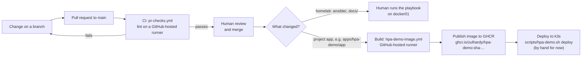

# homelab
This is a repo for my Devops Homelab

A free workspace on two Ubuntu VMs (Hyper-V) used to build and test a group capstone project:
a cloud-hosted web application with a database, deployed to Microsoft Azure.

- **This repo** sets up the workspace itself: VMs, Docker, Kubernetes (k3s), Ansible, CI/CD runner. It stays at home.
- **The capstone project** (website, database, pipelines) lives in its own repository (name not decided yet).
  It is on GitHub for now and moves to Azure DevOps later, where it runs on temporary Azure resources.
  This repo is not part of that move.


## The machines

| Machine | Specs | Role |
|---|---|---|
| docker01 (192.168.0.102) | Ubuntu 26.04.1, 4 CPU, 8 GB RAM, 38 GB disk | Control node: Ansible, GitHub Actions self-hosted runner, **k3s server** (Kubernetes control plane) |
| linux01 (192.168.0.103) | Ubuntu 26.04.1, 4 CPU, 8 GB RAM, 38 GB disk | **k3s agent**: runs the projects (see [Projects and packages](#projects-and-packages-built-and-tested-on-the-homelab-not-part-of-it)) |

## What's installed

| Component | Version | How | Docs |
|---|---|---|---|
| Docker (both VMs) | 29.10.0, Compose plugin 5.8.0 | [`ansible/playbooks/docker.yml`](ansible/playbooks/docker.yml): Docker's official repo, versions pinned and held | [BOOTSTRAP.md](docs/BOOTSTRAP.md) |
| GitHub Actions self-hosted runner (docker01) | 2.338.2 | [`ansible/playbooks/runner.yml`](ansible/playbooks/runner.yml): checksum-verified, runs as non-root `gha-runner` | [BOOTSTRAP.md](docs/BOOTSTRAP.md) |
| k3s Kubernetes (both VMs) | v1.37.2+k3s1 | [`ansible/playbooks/k3s.yml`](ansible/playbooks/k3s.yml): checksum-verified binary, no remote install script | [K3S.md](docs/K3S.md) |
| Included with k3s | | Traefik (ingress), Klipper-lb (load balancer), metrics-server (for autoscaling), CoreDNS | [K3S.md](docs/K3S.md) |

## Homelab pipelines (GitHub Actions)

| Workflow | When | Runs on | What it does |
|---|---|---|---|
| [`pr-checks.yml`](.github/workflows/pr-checks.yml) | Every pull request to `main` | GitHub-hosted runner | Lint: yamllint, Ansible syntax check, ansible-lint ([`scripts/lint.sh`](scripts/lint.sh)). Required to pass before merging. |

The self-hosted runner on docker01 is reserved for workflows that run **after** a merge to `main`.
Pull request checks never run on the homelab, because this repo is public.

## Projects and packages (built and tested on the homelab, not part of it)

These are separate projects that use the homelab as a place to build and run them. Each has its own folder,
pipeline and published package. They don't set up or change the homelab itself, and you don't need the homelab
to try them.

| Project | What it is | Folder and docs | Pipeline | Package |
|---|---|---|---|---|
| **hpa-demo** | Load balancing and autoscaling on Kubernetes (1 → 5 → 1 pods under load). Runs on any Kubernetes cluster with metrics-server. | [apps/hpa-demo](apps/hpa-demo/README.md) | [`hpa-demo-image.yml`](.github/workflows/hpa-demo-image.yml): on merge to `main` that changes the app, GitHub-hosted runner builds and pushes the image | [`ghcr.io/zulhardy/hpa-demo`](https://github.com/zulhardy/homelab/pkgs/container/hpa-demo) |

## How the CI/CD pipeline works

CI/CD here is **GitHub Actions**. Every change, whether to the homelab or to a project, follows the same path:



| Stage | Type | Where it runs | Triggered by | Gate |
|---|---|---|---|---|
| **1. Lint** ([`pr-checks.yml`](.github/workflows/pr-checks.yml) → [`scripts/lint.sh`](scripts/lint.sh)) | CI | GitHub-hosted runner | Every pull request to `main` | Must pass before merge (ruleset on `main`) |
| **2. Review and merge** | Manual | GitHub | A human | Only humans merge; direct pushes to `main` are blocked |
| **3a. Apply homelab changes** (Ansible playbooks) | Manual CD | docker01 | A human running `ansible-playbook ... -K` | Needs the human's sudo password |
| **3b. Build and publish a project image** ([`hpa-demo-image.yml`](.github/workflows/hpa-demo-image.yml) → [`scripts/build-image.sh`](scripts/build-image.sh)) | CI/CD | GitHub-hosted runner | Merge to `main` that changes the project's app | Uses GitHub's short-lived per-run token, `packages: write` only |
| **4. Deploy the project** ([`scripts/hpa-demo.sh`](scripts/hpa-demo.sh) `deploy`) | CD (manual for now) | docker01, using `kubectl` | A human | Deploys exactly the image tag built in 3b |

Design choices:

- **Pipeline logic lives in [`scripts/`](scripts/)**, and the workflow YAML only calls it. This keeps the later
  move to Azure Pipelines small: only the thin YAML wrappers need rewriting.
- **Images are tagged with the commit that changed the app** (`sha-<commit>`, see
  [`scripts/hpa-demo-image-tag.sh`](scripts/hpa-demo-image-tag.sh)), never `latest`. Build and deploy compute the
  same tag, so what's deployed is always what was built.
- **Pull requests never run on the homelab.** The repo is public, so PR checks use GitHub's runners. The
  self-hosted runner on docker01 is reserved for post-merge jobs.
- **Next step:** an automatic deploy job (stage 4) on the docker01 runner after merge, using its own limited
  Kubernetes credential instead of the admin one.

## Layout

```
ansible/              Ansible config, inventory, playbooks (Docker, runner, k3s)
apps/                 Projects built and run on the homelab (not part of it), e.g. apps/hpa-demo
scripts/              Pipeline and demo logic (workflow YAML only calls these)
.github/workflows/    Thin CI/CD wrappers
docs/BOOTSTRAP.md     One-time manual setup of the VMs and the repo
docs/K3S.md           The Kubernetes cluster: install, check, stop/start
CLAUDE.md             Rules for the AI agent working in this repo
```

## Security and safety

- **Every change goes through a pull request.** `main` is protected by a ruleset: PR required, `lint` must pass,
  no force pushes, no deletion.
- **No long-lived secrets in the repo.** Secret scanning and push protection are on. The image pipeline uses
  GitHub's short-lived per-run token.
- **Versions are pinned**: runner and k3s by checksum, container base images by digest, GitHub Actions by commit SHA.
- **Fork pull requests need approval** before any workflow runs.
- **Tested emergency stop**: `sudo systemctl stop actions.runner.zulhardy-homelab.docker01.service` on docker01.
- An AI agent helps write code here under the rules in [CLAUDE.md](CLAUDE.md). It can only propose changes as
  pull requests, holds no passwords, SSH keys or tokens, and doesn't run commands on the VMs.

## Getting started (rebuilding this homelab)

1. [docs/BOOTSTRAP.md](docs/BOOTSTRAP.md): GitHub repo settings, SSH, Docker, runner
2. [docs/K3S.md](docs/K3S.md): the Kubernetes cluster

Projects in `apps/` have their own READMEs (see [Projects and packages](#projects-and-packages-built-and-tested-on-the-homelab-not-part-of-it)).

## Change process

All changes go through pull requests. The `lint` check runs on GitHub's hosted runners and must pass.
A human reviews and merges.

## Known gaps

- No automatic deploy to the cluster yet. Projects are deployed by hand (e.g. `scripts/hpa-demo.sh deploy`).
- `ansible-playbook playbooks/docker.yml --check` stops partway on a brand-new VM (the Docker service doesn't exist
  yet during a dry run). Real runs are fine.
- Ansible uses classic `sudo` (`sudo.ws`) because Ubuntu 26.04's `sudo-rs` isn't yet compatible with it
  (see [`ansible/ansible.cfg`](ansible/ansible.cfg)).
