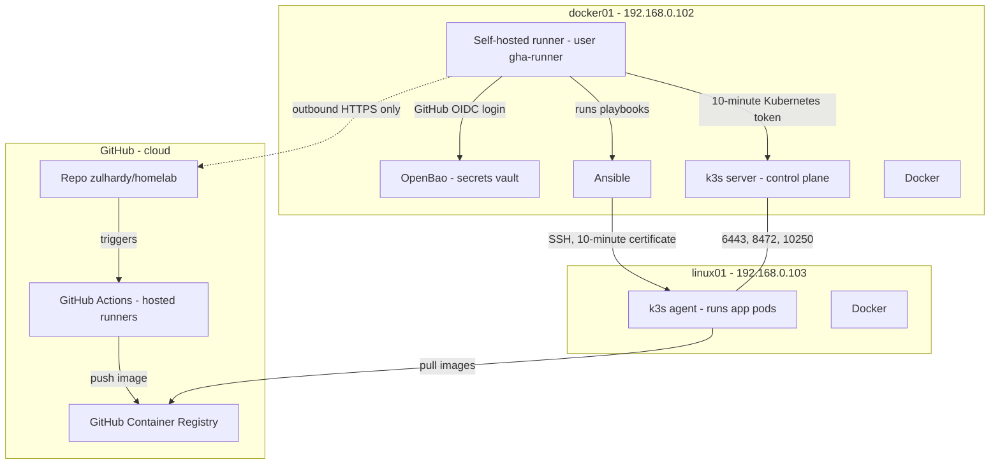
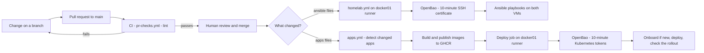

# homelab
This is a repo for my Devops Homelab

A free workspace on two Ubuntu VMs (Hyper-V) used to build and test a group capstone project:
a cloud-hosted web application with a database, deployed to Microsoft Azure.

**The only manual step is reviewing and merging a pull request.** After a merge, pipelines apply homelab changes
to both VMs, and build, onboard and deploy every app, using credentials that are created for each run and expire
after 10 minutes. See [docs/AUTOMATION.md](docs/AUTOMATION.md).

- **This repo** sets up the workspace itself: VMs, Docker, Kubernetes (k3s), Ansible, CI/CD runner. It stays at home.
- **The capstone project** (website, database, pipelines) lives in its own repository (name not decided yet).
  It is on GitHub for now and moves to Azure DevOps later, where it runs on temporary Azure resources.
  This repo is not part of that move.


## The machines

| Machine | Specs | Role |
|---|---|---|
| docker01 (192.168.0.102) | Ubuntu 26.04.1, 4 CPU, 8 GB RAM, 38 GB disk | Control node: Ansible, GitHub Actions self-hosted runner, **k3s server** (Kubernetes control plane) |
| linux01 (192.168.0.103) | Ubuntu 26.04.1, 4 CPU, 8 GB RAM, 38 GB disk | **k3s agent**: runs the projects (see [Projects and packages](#projects-and-packages-built-and-tested-on-the-homelab-not-part-of-it)) |

## DevOps components

### Architecture at a glance



k3s ports between the nodes: 6443/tcp (Kubernetes API), 8472/udp (Flannel VXLAN networking), 10250/tcp (kubelet).

### Components in detail

| Area | Tool | Version | Where | What it does here | Managed by |
|---|---|---|---|---|---|
| **Version control & change management** | GitHub | n/a | Cloud | Single source of truth. `main` protected by the `protect-main` ruleset: PR required, `lint` must pass, no force push, no deletion | Repo settings (by hand) |
| **Continuous integration** | GitHub Actions (GitHub-hosted runners) | `ubuntu-24.04` image | Cloud | Lints every pull request; detects changed apps and builds their images after merge | [`.github/workflows/`](.github/workflows/) |
| **Continuous deployment** | GitHub Actions self-hosted runner | 2.338.2 | docker01 | Runs the post-merge jobs inside the home network: applies the playbooks, onboards and deploys apps. Connects **out** to GitHub only; no inbound ports | [`homelab.yml`](.github/workflows/homelab.yml), [`apps.yml`](.github/workflows/apps.yml), [`runner.yml`](ansible/playbooks/runner.yml) |
| **Configuration management / IaC** | Ansible | from Ubuntu 26.04 repos | docker01 → both VMs | Installs and configures everything on the VMs, idempotently (re-running changes only what differs). Run by the homelab pipeline after every merge to `ansible/` | [`ansible/`](ansible/) |
| **Containers** | Docker Engine + Compose plugin | 29.10.0 / 5.8.0 | Both VMs | Builds and runs containers outside Kubernetes. Versions pinned and put on apt hold | [`docker.yml`](ansible/playbooks/docker.yml) |
| **Container orchestration** | k3s (Kubernetes) | v1.37.2+k3s1 | docker01 = server, linux01 = agent | Runs project workloads as pods, restarts failed ones, spreads them across nodes | [`k3s.yml`](ansible/playbooks/k3s.yml), [K3S.md](docs/K3S.md) |
| **Ingress / external load balancing** | Traefik + Klipper-lb (bundled with k3s) | bundled | Both VMs, port 80/443 | Receives HTTP traffic on the VMs and routes it to the right Service by host name | k3s |
| **Internal load balancing** | Kubernetes Service | n/a | Cluster | Spreads requests across all ready pods of an app | Each project's manifests |
| **Autoscaling** | metrics-server (bundled) + HorizontalPodAutoscaler | bundled | Cluster | Measures pod CPU; the HPA adds or removes pods to hit a CPU target | Each project's manifests |
| **Service discovery** | CoreDNS (bundled) | bundled | Cluster | Lets pods find Services by name, e.g. `http://hpa-demo.hpa-demo.svc` | k3s |
| **Container registry** | GitHub Container Registry (GHCR) | n/a | Cloud | Stores the images built by the pipeline; the cluster pulls from here | Project pipelines |
| **Secrets & supply chain** | GitHub secret scanning + push protection; pinning | n/a | Cloud + repo | Blocks pushes containing known secret types. Runner and k3s verified by SHA-256, base images pinned by digest, Actions pinned by commit SHA | Repo settings, playbooks |
| **Secrets vault / credential broker** | OpenBao | 2.7.3 | docker01, 127.0.0.1:8200 only | Checks each pipeline job's GitHub OIDC token, then hands out 10-minute SSH certificates and Kubernetes tokens. Unseals itself after restarts (key file on docker01) | [`openbao.yml`](ansible/playbooks/openbao.yml), [OPENBAO.md](docs/OPENBAO.md) |
| **Machine access for the pipeline** | OpenSSH certificates + `automation` user | OpenSSH from Ubuntu | Both VMs | The pipeline logs in as `automation` (passwordless sudo) only with an OpenBao-signed certificate valid 10 minutes. No keys or passwords stored | [`automation-access.yml`](ansible/playbooks/automation-access.yml) |
| **Monitoring** | `kubectl top` via metrics-server | bundled | Cluster | Live CPU/memory per node and pod. No dashboards or alerting yet | n/a |

### How each layer is secured

| Layer | Control |
|---|---|
| Code | Every change via pull request; `lint` required; only humans merge |
| Pipeline | PR checks run on GitHub's runners, never on the homelab; fork PR workflows need approval; per-run tokens with minimum permissions (`contents: read`, `packages: write` / `id-token: write` only where needed); OpenBao only trusts `homelab.yml` and `apps.yml` on `main` of this repo |
| Runner | Runs as non-root `gha-runner`; its directory is readable only by that user; reserved for post-merge jobs |
| VMs | The pipeline's `automation` user accepts only OpenBao-signed 10-minute SSH certificates (no password, no keys); humans' sudo still requires a password; Ansible uses classic `sudo.ws` (see [`ansible.cfg`](ansible/ansible.cfg)) |
| Kubernetes | Admin kubeconfig on docker01 only (mode 0600); agent join token in a root-only file; deploys use a per-app `deployer` account (no secrets, no deletes, one namespace); onboarding uses a cluster-admin account, only through 10-minute tokens; app pods run non-root with read-only filesystems and no capabilities |
| Secrets | OpenBao on loopback only, TLS; root token revoked after setup; recovery keys held by the human in a password manager; auto-unseal key on docker01 (backed up by the human) |
| **Accepted trade-off** | **Merging to `main` can change anything** on both VMs and in the cluster, through the pipeline. The review before merge is the control. |
| Supply chain | No `latest` tags anywhere; downloads verified by checksum or digest; no `curl \| sh` install scripts |

### Planned

| Component | Purpose |
|---|---|
| LitmusChaos (pinned 3.33.0) | Chaos experiments, e.g. killing pods to show self-healing |
| Monitoring dashboards (e.g. Prometheus + Grafana) | History and alerts instead of only live `kubectl top` |

## Homelab pipelines (GitHub Actions)

| Workflow | When | Runs on | What it does |
|---|---|---|---|
| [`pr-checks.yml`](.github/workflows/pr-checks.yml) | Every pull request to `main` | GitHub-hosted runner | Lint: yamllint, Ansible syntax check, ansible-lint ([`scripts/lint.sh`](scripts/lint.sh)). Required to pass before merging. |
| [`homelab.yml`](.github/workflows/homelab.yml) | Merge to `main` that changes `ansible/` | docker01 runner | Applies `docker.yml`, `k3s.yml`, `openbao.yml`, `automation-access.yml` to both VMs ([`scripts/ci-homelab.sh`](scripts/ci-homelab.sh)) |

The self-hosted runner on docker01 is reserved for workflows that run **after** a merge to `main`.
Pull request checks never run on the homelab, because this repo is public.

## Projects and packages (built and tested on the homelab, not part of it)

These are separate projects that use the homelab as a place to build and run them. Each has its own folder,
pipeline and published package. They don't set up or change the homelab itself, and you don't need the homelab
to try them.

All apps use the same pipeline, [`apps.yml`](.github/workflows/apps.yml): on merge, it builds each changed app's
image, **onboards new apps automatically** and deploys them. To add one, see
[Adding an app](docs/AUTOMATION.md#adding-an-app).

| Project | What it is | Folder and docs | Package |
|---|---|---|---|
| **hpa-demo** | Load balancing and autoscaling on Kubernetes (1 → 5 → 1 pods under load). Runs on any Kubernetes cluster with metrics-server. | [apps/hpa-demo](apps/hpa-demo/README.md) | [`ghcr.io/zulhardy/hpa-demo`](https://github.com/zulhardy/homelab/pkgs/container/hpa-demo) |

## How the CI/CD pipeline works

CI/CD here is **GitHub Actions**. Every change, whether to the homelab or to an app, follows the same path.
**Review and merge is the only manual step.**



| Stage | Type | Where it runs | Triggered by | Gate |
|---|---|---|---|---|
| **1. Lint** ([`pr-checks.yml`](.github/workflows/pr-checks.yml) → [`scripts/lint.sh`](scripts/lint.sh)) | CI | GitHub-hosted runner | Every pull request to `main` | Must pass before merge (ruleset on `main`) |
| **2. Review and merge** | **Manual (the only one)** | GitHub | A human | Only humans merge; direct pushes to `main` are blocked |
| **3a. Apply homelab changes** ([`homelab.yml`](.github/workflows/homelab.yml) → [`scripts/ci-homelab.sh`](scripts/ci-homelab.sh)) | CD, automatic | docker01 self-hosted runner | Merge that changes `ansible/` | OpenBao checks the job's GitHub OIDC token, signs a 10-minute SSH certificate for `automation`; Ansible runs over SSH |
| **3b. Detect and build apps** ([`apps.yml`](.github/workflows/apps.yml) → [`scripts/changed-apps.sh`](scripts/changed-apps.sh), [`scripts/build-image.sh`](scripts/build-image.sh)) | CI | GitHub-hosted runner | Merge that changes `apps/` | GitHub's short-lived per-run token, `packages: write` only; images reused if unchanged |
| **4. Onboard and deploy apps** ([`scripts/ci-apps.sh`](scripts/ci-apps.sh) → [`onboard-app.sh`](scripts/onboard-app.sh), [`deploy.sh`](scripts/deploy.sh)) | CD, automatic | docker01 self-hosted runner | Stage 3b succeeding | New apps get a namespace and `deployer` account (10-minute admin token); deploys use the app's own 10-minute `deployer` token; fails if the rollout isn't healthy |

Design choices:

- **Pipeline logic lives in [`scripts/`](scripts/)**, and the workflow YAML only calls it. This keeps the later
  move to Azure Pipelines small: only the thin YAML wrappers need rewriting.
- **Images are tagged with the commit that changed the app** (`sha-<commit>`, see
  [`scripts/image-tag.sh`](scripts/image-tag.sh)), never `latest`. Build and deploy compute the
  same tag, so what's deployed is always what was built.
- **Pull requests never run on the homelab.** The repo is public, so PR checks use GitHub's runners. The
  self-hosted runner on docker01 is reserved for post-merge jobs.
- **No stored pipeline credentials.** Each job proves who it is with GitHub's OIDC token; OpenBao checks the
  repo, branch and workflow file, then hands out SSH certificates and Kubernetes tokens that expire after 10 minutes
  (see [docs/OPENBAO.md](docs/OPENBAO.md)).
- **One job at a time on docker01.** There is a single self-hosted runner, so homelab and app jobs queue.

## Layout

```
ansible/              Ansible config, inventories (hosts.ini for humans, automation.ini for the pipeline), playbooks
apps/                 Projects built and run on the homelab (not part of it), e.g. apps/hpa-demo
scripts/              Pipeline and demo logic (workflow YAML only calls these)
.github/workflows/    Thin CI/CD wrappers
docs/BOOTSTRAP.md     One-time manual setup of the VMs and the repo
docs/K3S.md           The Kubernetes cluster: install, check, stop/start
docs/OPENBAO.md       The secrets vault: install, auto-unseal, recovery keys, how pipelines log in
docs/AUTOMATION.md    The pipelines, the one-time bootstrap, adding an app, trade-offs
CLAUDE.md             Rules for the AI agent working in this repo
```

## Security and safety

- **Every change goes through a pull request.** `main` is protected by a ruleset: PR required, `lint` must pass,
  no force pushes, no deletion.
- **No long-lived secrets in the repo or the pipelines.** Secret scanning and push protection are on. Pipelines use
  GitHub's short-lived tokens and 10-minute credentials from OpenBao.
- **Versions are pinned**: runner and k3s by checksum, container base images by digest, GitHub Actions by commit SHA.
- **Fork pull requests need approval** before any workflow runs.
- **Emergency stop** (tested): `sudo systemctl stop actions.runner.zulhardy-homelab.docker01.service` on docker01
  stops all post-merge jobs. `sudo systemctl stop openbao` stops all pipeline credentials.
- An AI agent helps write code here under the rules in [CLAUDE.md](CLAUDE.md). It can only propose changes as
  pull requests, holds no passwords, SSH keys or tokens, and doesn't run commands on the VMs.

## Getting started (rebuilding this homelab)

1. [docs/BOOTSTRAP.md](docs/BOOTSTRAP.md): GitHub repo settings, SSH, Docker, runner
2. [docs/K3S.md](docs/K3S.md): the Kubernetes cluster
3. [docs/OPENBAO.md](docs/OPENBAO.md): the secrets vault
4. [docs/AUTOMATION.md](docs/AUTOMATION.md): the one-time bootstrap that makes everything after merge automatic

Projects in `apps/` have their own READMEs (see [Projects and packages](#projects-and-packages-built-and-tested-on-the-homelab-not-part-of-it)).

## Change process

All changes go through pull requests. The `lint` check runs on GitHub's hosted runners and must pass.
A human reviews and merges. Everything after the merge is automatic.

## Known gaps

- `runner.yml` isn't run by the pipeline: it would restart the runner in the middle of its own job, and it needs a
  fresh registration token. Runner updates are done by hand (rarely).
- Deleting an app folder doesn't remove the app from the cluster. Removing running apps is a manual step on purpose.
- `ansible-playbook playbooks/docker.yml --check` stops partway on a brand-new VM (the Docker service doesn't exist
  yet during a dry run). Real runs are fine.
- Ansible uses classic `sudo` (`sudo.ws`) because Ubuntu 26.04's `sudo-rs` isn't yet compatible with it
  (see [`ansible/ansible.cfg`](ansible/ansible.cfg)).
