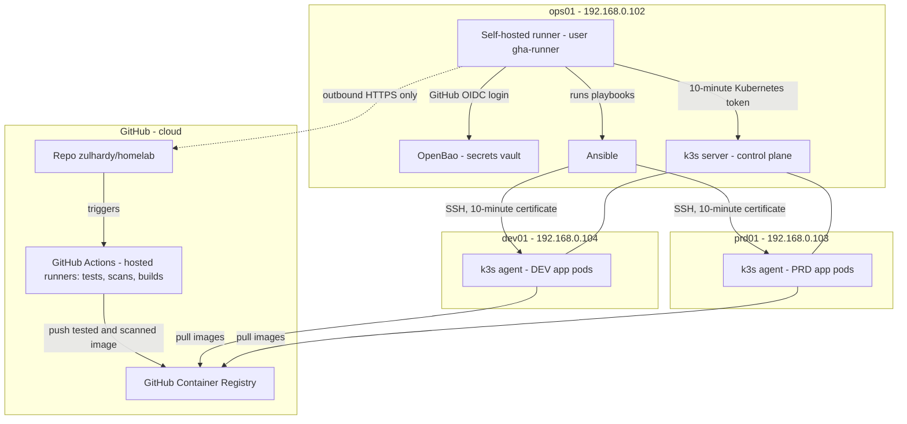
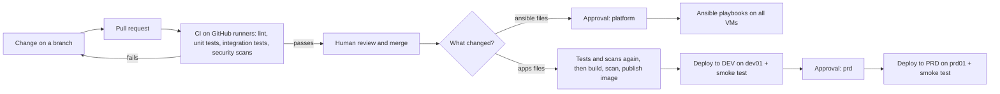

# homelab
This is a repo for my Devops Homelab

A free workspace on three Ubuntu VMs (Hyper-V) used to build and test a group capstone project:
a cloud-hosted web application with a database, deployed to Microsoft Azure.

**Humans only review and merge pull requests, and approve high-risk steps** (production deploys and
infrastructure changes). Everything else is automatic: tests, security scans, image builds, and the DEV deploy.
Credentials are created for each run and expire after 10 minutes. See [docs/AUTOMATION.md](docs/AUTOMATION.md).

- **This repo** sets up the workspace itself: VMs, Kubernetes (k3s), Ansible, CI/CD, the secrets vault. It stays at home.
- **The capstone project** (website, database, pipelines) lives in its own repository (name not decided yet).
  It is on GitHub for now and moves to Azure DevOps later, where it runs on temporary Azure resources.
  This repo is not part of that move.


## The machines

| Machine | Specs | Role |
|---|---|---|
| **ops01** (192.168.0.102), was docker01 | Ubuntu 26.04.1, 4 CPU, 8 GB RAM | Operations: **k3s server** (Kubernetes control plane), GitHub Actions self-hosted runner, OpenBao (secrets vault), Ansible. **Runs no app pods** |
| **prd01** (192.168.0.103), was linux01 | Ubuntu 26.04.1, 4 CPU, 8 GB RAM | **k3s agent, PRD only**: production copy of every app |
| **dev01** (192.168.0.104), new | Ubuntu 26.04.1, 4 CPU, 8 GB RAM | **k3s agent, DEV only**: development copy of every app |

DEV and PRD are separated by **node and namespace**: each app has `<app>-dev` and `<app>-prd` namespaces, and
Kubernetes forces their pods onto dev01 and prd01 respectively (details in [docs/K3S.md](docs/K3S.md)).

## DevOps components

### Architecture at a glance



k3s ports between the nodes: 6443/tcp (Kubernetes API), 8472/udp (Flannel VXLAN networking), 10250/tcp (kubelet).

### Components in detail

| Area | Tool | Version | Where | What it does here | Managed by |
|---|---|---|---|---|---|
| **Version control & change management** | GitHub | n/a | Cloud | Single source of truth. `main` protected by the `protect-main` ruleset: PR required, checks must pass, no force push, no deletion | Repo settings (by hand) |
| **Continuous integration** | GitHub Actions (GitHub-hosted runners) | `ubuntu-24.04` image | Cloud | Every PR: lint, unit tests, integration tests, security scans. After merge: the same tests, then build and publish images | [`.github/workflows/`](.github/workflows/) |
| **Testing** | Python `unittest` (standard library), shell integration tests | n/a | GitHub-hosted runners, then the cluster | Unit tests per app; integration test against the built container; smoke test through the Ingress after each DEV and PRD deploy | [`scripts/unit-test.sh`](scripts/unit-test.sh), [`integration-test.sh`](scripts/integration-test.sh) |
| **Security scanning** | Trivy (Apache-2.0, free) | 0.76.2, binary pinned by SHA-256 | GitHub-hosted runners | Secrets, misconfigurations (Dockerfiles, Kubernetes, Ansible) and vulnerabilities in the repo and in every image before it's published | [`scripts/security-scan.sh`](scripts/security-scan.sh) |
| **Environments & approvals** | GitHub Environments `dev`, `prd`, `platform` | n/a | Cloud | `dev`: no approval. `prd` and `platform`: a human approves before the job starts | Repo settings (by hand) |
| **Continuous deployment** | GitHub Actions self-hosted runner | 2.338.2 | ops01 | Runs the post-merge jobs inside the home network: applies the playbooks, onboards and deploys apps. Connects **out** to GitHub only; no inbound ports | [`homelab.yml`](.github/workflows/homelab.yml), [`apps.yml`](.github/workflows/apps.yml), [`runner.yml`](ansible/playbooks/runner.yml) |
| **Configuration management / IaC** | Ansible | from Ubuntu 26.04 repos | ops01 → all VMs | Installs and configures everything on the VMs, idempotently. Run by the homelab pipeline after an approved merge to `ansible/` | [`ansible/`](ansible/) |
| **Container orchestration** | k3s (Kubernetes) | v1.37.2+k3s1 | ops01 = server, prd01 / dev01 = agents | Runs app pods, restarts failed ones; keeps DEV pods on dev01 and PRD pods on prd01 | [`k3s.yml`](ansible/playbooks/k3s.yml), [K3S.md](docs/K3S.md) |
| **Ingress / external load balancing** | Traefik + Klipper-lb (bundled with k3s) | bundled | All VMs, port 80/443 | Receives HTTP traffic and routes it to the right Service by host name | k3s |
| **Internal load balancing** | Kubernetes Service | n/a | Cluster | Spreads requests across all ready pods of an app | Each project's manifests |
| **Autoscaling** | metrics-server (bundled) + HorizontalPodAutoscaler | bundled | Cluster | Measures pod CPU; the HPA adds or removes pods to hit a CPU target | Each project's manifests |
| **Service discovery** | CoreDNS (bundled) | bundled | Cluster | Lets pods find Services by name, e.g. `http://hpa-demo.hpa-demo-dev.svc` | k3s |
| **Container registry** | GitHub Container Registry (GHCR) | n/a | Cloud | Stores the images built by the pipeline; the cluster pulls from here | Project pipelines |
| **Secrets & supply chain** | GitHub secret scanning + push protection; pinning | n/a | Cloud + repo | Blocks pushes containing known secret types. Runner, k3s, Trivy, OpenBao verified by SHA-256; base images pinned by digest; Actions pinned by commit SHA | Repo settings, playbooks |
| **Secrets vault / credential broker** | OpenBao | 2.7.3 | ops01, 127.0.0.1:8200 only | Checks each pipeline job's GitHub OIDC token (repo, branch, workflow, **environment**), then hands out 10-minute SSH certificates and Kubernetes tokens. Unseals itself after restarts | [`openbao.yml`](ansible/playbooks/openbao.yml), [OPENBAO.md](docs/OPENBAO.md) |
| **Machine access for the pipeline** | OpenSSH certificates + `automation` user | OpenSSH from Ubuntu | All VMs | The pipeline logs in as `automation` only with an OpenBao-signed certificate valid 10 minutes. No keys or passwords stored | [`automation-access.yml`](ansible/playbooks/automation-access.yml) |
| **Monitoring** | `kubectl top` via metrics-server | bundled | Cluster | Live CPU/memory per node and pod. No dashboards or alerting yet | n/a |

Docker is **not** installed on the VMs any more: images are built and tested on GitHub's runners, and k3s has its
own container runtime (containerd). Removing it also removed the runner's `docker` group membership, which was
effectively root access.

### How each layer is secured

| Layer | Control |
|---|---|
| Code | Every change via pull request; the `quality` check (lint, tests, scans) required; only humans merge |
| Pipeline | PR checks run on GitHub's runners, never on the homelab; fork PR workflows need approval; per-run tokens with minimum permissions; OpenBao trusts only `homelab.yml` / `apps.yml` on `main` of this repo, and gives PRD or admin credentials only to jobs whose GitHub environment (`prd`, `platform`) was approved |
| Runner | Runs as non-root `gha-runner` (not in the `docker` group); reserved for post-merge jobs |
| VMs | The pipeline's `automation` user accepts only OpenBao-signed 10-minute SSH certificates; humans' sudo still requires a password; Ansible uses classic `sudo.ws` (see [`ansible.cfg`](ansible/ansible.cfg)) |
| Kubernetes | Admin kubeconfig on ops01 only (mode 0600); each app has a separate `deployer` per environment (no secrets, no deletes, one namespace); a DEV deployer can't touch PRD; PodNodeSelector keeps DEV pods on dev01 and PRD pods on prd01; app pods run non-root with read-only filesystems and no capabilities |
| Secrets | OpenBao on loopback only, TLS; root token revoked after setup; recovery keys held by the human; auto-unseal key on ops01 (backed up by the human) |
| **Accepted trade-off** | **An approved homelab run can change anything** on the VMs and in the cluster. The review before merge, plus the approval, is the control. |
| Supply chain | No `latest` tags anywhere; downloads verified by checksum or digest; no `curl \| sh` install scripts; Trivy installed as a pinned binary, not through a third-party Action |

### Planned

| Component | Purpose |
|---|---|
| LitmusChaos (pinned 3.33.0) | Chaos experiments, e.g. killing pods to show self-healing |
| Monitoring dashboards (e.g. Prometheus + Grafana) | History and alerts instead of only live `kubectl top` |

## Projects and packages (built and tested on the homelab, not part of it)

These are separate projects that use the homelab as a place to build and run them. They don't set up or change the
homelab itself, and you don't need the homelab to try them.

All apps use the same pipeline, [`apps.yml`](.github/workflows/apps.yml). To add one, see
[Adding an app](docs/AUTOMATION.md#adding-an-app).

| Project | What it is | Folder and docs | DEV / PRD address | Package |
|---|---|---|---|---|
| **hpa-demo** | Load balancing and autoscaling on Kubernetes (1 → 5 → 1 pods under load). Runs on any Kubernetes cluster with metrics-server. | [apps/hpa-demo](apps/hpa-demo/README.md) | `hpa-demo.192.168.0.104.nip.io` / `hpa-demo.192.168.0.103.nip.io` | [`ghcr.io/zulhardy/hpa-demo`](https://github.com/zulhardy/homelab/pkgs/container/hpa-demo) |

## How the CI/CD pipeline works

CI/CD here is **GitHub Actions** on free resources: GitHub-hosted runners (free for public repos), GitHub
Environments (free for public repos), GHCR, Trivy, and the homelab itself.



| Stage | Where it runs | Approval? | What it does |
|---|---|---|---|
| **1. PR checks** ([`pr-checks.yml`](.github/workflows/pr-checks.yml)) | GitHub-hosted | No | Lint (yamllint, ansible-lint, shellcheck), Trivy repo scan, and per changed app: unit tests, image build, integration test against the container, image scan. One summary check, `quality`, must pass before merge |
| **2. Review and merge** | GitHub | **Human** | Only humans merge; direct pushes to `main` are blocked |
| **3. Apply homelab changes** ([`homelab.yml`](.github/workflows/homelab.yml)) | ops01 runner | **Yes** (`platform`) | 10-minute SSH certificate from OpenBao; runs `base.yml`, `k3s.yml`, `openbao.yml`, `automation-access.yml` on all VMs |
| **4. Test, scan and build apps** ([`apps.yml`](.github/workflows/apps.yml)) | GitHub-hosted | No | Unit tests and repo scan again on the merged code; build, integration test, image scan; only then push to GHCR |
| **5. Onboard new apps** | ops01 runner | **Yes** (`platform`) | Only for apps not set up yet: `<app>-dev` / `<app>-prd` namespaces, deployer accounts, OpenBao roles |
| **6. Deploy to DEV** | ops01 runner | No (`dev`) | DEV deployer token (10 minutes); rollout check; smoke test through the DEV address |
| **7. Deploy to PRD** | ops01 runner | **Yes** (`prd`) | PRD deployer token (10 minutes); rollout check; smoke test through the PRD address |

Design choices:

- **Pipeline logic lives in [`scripts/`](scripts/)**, and the workflow YAML only calls it. This keeps the later
  move to Azure Pipelines small.
- **Build once, deploy the same image to DEV and PRD.** Images are tagged with the commit that changed the app
  (`sha-<commit>`, [`scripts/image-tag.sh`](scripts/image-tag.sh)), never `latest`.
- **Approvals only where the risk is**: PRD deploys, homelab infrastructure, onboarding (new namespaces, accounts and
  vault roles). Tests, scans, builds and DEV deploys need no approval.
- **Approvals are enforced twice**: GitHub won't start the job until a reviewer approves, and OpenBao won't hand out
  PRD or admin credentials to a job whose token doesn't name the approved environment.
- **One job at a time on ops01.** There is a single self-hosted runner, so homelab and app jobs queue.

## Layout

```
ansible/              Ansible config, inventories (hosts.ini for humans, automation.ini for the pipeline), playbooks
apps/                 Projects built and run on the homelab (not part of it), e.g. apps/hpa-demo
scripts/              Pipeline and demo logic (workflow YAML only calls these)
.github/workflows/    Thin CI/CD wrappers
docs/BOOTSTRAP.md     One-time manual setup of the VMs and the repo
docs/K3S.md           The Kubernetes cluster, DEV/PRD nodes, renaming nodes
docs/OPENBAO.md       The secrets vault: install, auto-unseal, recovery keys, how pipelines log in
docs/AUTOMATION.md    The pipelines, approvals, the one-time bootstrap, adding an app, trade-offs
CLAUDE.md             Rules for the AI agent working in this repo
```

## Security and safety

- **Every change goes through a pull request.** `main` is protected by a ruleset: PR required, checks must pass,
  no force pushes, no deletion.
- **No long-lived secrets in the repo or the pipelines.** Secret scanning and push protection are on; Trivy scans
  for secrets too. Pipelines use GitHub's short-lived tokens and 10-minute credentials from OpenBao.
- **Versions are pinned**: runner, k3s, OpenBao and Trivy by checksum, container base images by digest, GitHub
  Actions by commit SHA.
- **Fork pull requests need approval** before any workflow runs.
- **Emergency stop**: `sudo systemctl stop 'actions.runner.*'` on ops01 stops all post-merge jobs.
  `sudo systemctl stop openbao` stops all pipeline credentials.
- An AI agent helps write code here under the rules in [CLAUDE.md](CLAUDE.md). It can only propose changes as
  pull requests, holds no passwords, SSH keys or tokens, and doesn't run commands on the VMs.

## Getting started (rebuilding this homelab)

1. [docs/BOOTSTRAP.md](docs/BOOTSTRAP.md): GitHub repo settings, SSH, runner
2. [docs/K3S.md](docs/K3S.md): the Kubernetes cluster
3. [docs/OPENBAO.md](docs/OPENBAO.md): the secrets vault
4. [docs/AUTOMATION.md](docs/AUTOMATION.md): GitHub environments and the one-time bootstrap

## Known gaps

- `runner.yml` isn't run by the pipeline: it would restart the runner in the middle of its own job, and it needs a
  fresh registration token. Runner updates are done by hand (rarely).
- Deleting an app folder doesn't remove the app from the cluster. Removing running apps is a manual step on purpose.
- DEV and PRD share one cluster (one control plane, one Traefik). Separate clusters would isolate them further, at
  the cost of more RAM; the capstone's Azure setup can use separate resources per environment.
- [Unverified] PodNodeSelector only applies a namespace's node rule to the pod's `nodeSelector`; a manifest that
  sets `nodeName` directly could bypass the scheduler. Manifests are reviewed in pull requests.
- Ansible uses classic `sudo` (`sudo.ws`) because Ubuntu 26.04's `sudo-rs` isn't yet compatible with it
  (see [`ansible/ansible.cfg`](ansible/ansible.cfg)).
