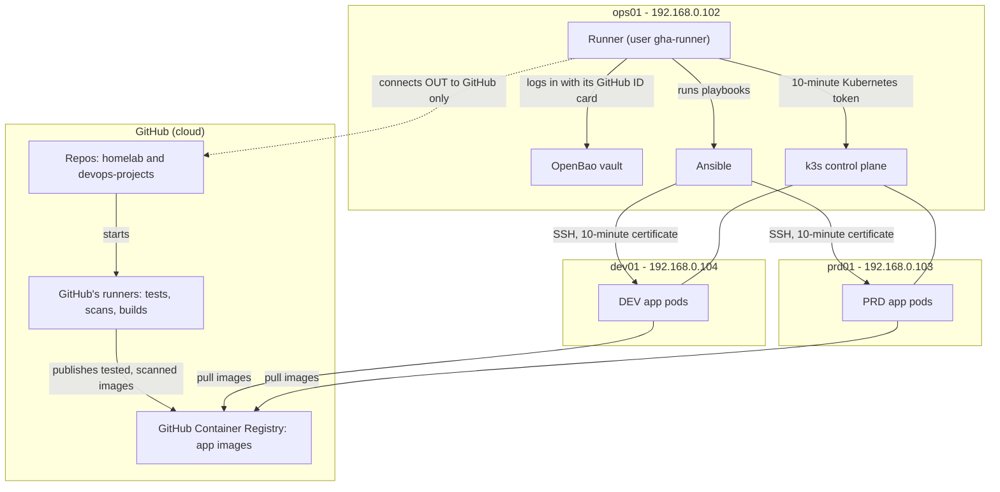
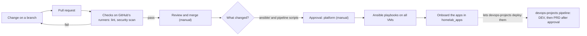

# homelab

A DevOps homelab: three Ubuntu virtual machines (VMs) at home, set up as a small but realistic platform for building,
testing and deploying apps, the way a company would. It's used to author and test a group capstone project (a web
app with a database, hosted on Microsoft Azure), and to learn and show DevOps skills along the way.

This page explains **what's in the homelab and how it works**, in plain language. Every term is explained the first
time it appears, and there's a word list below. To **build** one yourself, start with
[docs/BOOTSTRAP.md](docs/BOOTSTRAP.md), a step-by-step guide.

## Contents

- [The three repositories](#the-three-repositories)
- [Words you'll see](#words-youll-see)
- [The machines](#the-machines)
- [The big picture](#the-big-picture)
- [How a change reaches the homelab, step by step](#how-a-change-reaches-the-homelab-step-by-step)
- [What each tool does](#what-each-tool-does)
- [How each part is kept safe](#how-each-part-is-kept-safe)
- [Apps that run here](#apps-that-run-here)
- [What's in this repo](#whats-in-this-repo)
- [Guides: rebuild it yourself](#guides-rebuild-it-yourself)
- [Known gaps](#known-gaps)

## The three repositories

| Repository | What it holds |
|---|---|
| **homelab** (this one) | The platform itself: the VMs' setup, Kubernetes, the secrets vault, the pipeline runner, and **which apps are allowed to run** here. It stays at home |
| **[devops-projects](https://github.com/zulhardy-lab/devops-projects)** | Small apps to learn with (e.g. hpa-demo). It tests, builds and deploys them, but can only deploy apps this repo has allowed |
| **The capstone project** | Its own repository (name not decided yet): on GitHub for now, moving to Azure DevOps later, running on temporary Azure resources. Not part of this repo |

**Two steps are always done manually: reviewing and merging pull requests, and approving the risky steps**
(production deploys and infrastructure changes). Everything else runs automatically: tests, security scans, image
builds and DEV deploys.

## Words you'll see

| Word | Meaning |
|---|---|
| **VM** (virtual machine) | A computer simulated in software. Here: ops01, prd01 and dev01, on Hyper-V |
| **Pull request (PR)** | "Here are my changes, please add them to `main`." Checks run on it before it can be merged |
| **Pipeline / workflow** | Automatic steps GitHub runs after an event, e.g. a merge (`.github/workflows/*.yml`) |
| **Runner** | The computer that runs a pipeline's steps. GitHub has its own; this homelab also has one at home, on ops01 |
| **Ansible / playbook** | A tool that sets up machines from a written description (a *playbook*), the same way every time |
| **Kubernetes / k3s** | Software that runs apps in containers across several machines and keeps them running. k3s is a small version |
| **Node** | One machine in the Kubernetes cluster |
| **Namespace** | A separate area inside Kubernetes. Each app gets `<app>-dev` and `<app>-prd` |
| **DEV / PRD** | Two environments: DEV (development) for trying changes, PRD (production) for the "real" copy |
| **OpenBao** | A secrets vault. Here it hands pipelines credentials that expire after 10 minutes |
| **OIDC token** | A short-lived ID card GitHub gives each pipeline run, saying which repo, branch and workflow it is |
| **Onboarding** | Allowing an app to run here: giving it namespaces, accounts and vault roles |
| **Trivy** | A scanner that looks for leaked secrets, unsafe settings and known vulnerabilities |
| **Pinned** | Fixed to an exact version and checked by checksum, so nothing changes without you knowing |

## The machines

| Machine | Size | Role |
|---|---|---|
| **ops01** (192.168.0.102) | Ubuntu 26.04.1, 4 GB RAM, 4 vCPU | The "operations" machine: Kubernetes **control plane** (k3s server), the pipeline **runner**, the **OpenBao** vault, **Ansible**. Runs no app pods |
| **prd01** (192.168.0.103) | Ubuntu 26.04.1, 2 GB RAM, 4 vCPU | Kubernetes worker for **PRD** apps only |
| **dev01** (192.168.0.104) | Ubuntu 26.04.1, 2 GB RAM, 4 vCPU | Kubernetes worker for **DEV** apps only |

DEV and PRD are kept apart in two ways: each app has its own `<app>-dev` and `<app>-prd` namespaces, and Kubernetes
forces their pods onto dev01 and prd01 respectively. [docs/K3S.md](docs/K3S.md) explains how.

## The big picture



Three things to notice:

1. **Nothing at home is open to the internet.** The runner connects *out* to GitHub and asks for work; GitHub never
   connects in.
2. **No passwords or keys are stored in the pipelines.** Each run proves who it is with GitHub's ID card, and
   OpenBao gives it credentials that expire after 10 minutes.
3. **Apps are built and checked in the cloud, not at home.** The VMs only download finished, scanned images.

The nodes talk to each other on 6443/tcp (Kubernetes API), 8472/udp (Flannel networking) and 10250/tcp (kubelet).

## How a change reaches the homelab, step by step



**Step 1: Open a pull request.** You change something on a branch, e.g. a playbook in `ansible/`, and open a PR.

**Step 2: PR checks run** on GitHub's machines ([`pr-checks.yml`](.github/workflows/pr-checks.yml)), never at home:
the files are checked for mistakes (yamllint, Ansible's syntax check and ansible-lint, shellcheck) and Trivy scans
the repo. A summary check, `quality`, must pass before the PR can be merged.

**Step 3: Review and merge (manual).** `main` is protected: you can't push to it directly.

**Step 4: Approve the platform run (manual).** If the merge changed `ansible/` or the pipeline's scripts, the
[`homelab.yml`](.github/workflows/homelab.yml) pipeline starts and **waits** for approval in the `platform`
environment (**Actions** → the run → **Review deployments**).

**Step 5: Apply the change.** After approval, the runner on ops01 gets a 10-minute SSH certificate from OpenBao and
runs the playbooks on all three VMs: `base.yml`, `k3s.yml`, `openbao.yml`, `automation-access.yml`. Running them
again when nothing changed is safe: they only fix what's different.

**Step 6: Onboard the allowed apps** (same run). With a 10-minute admin token, it makes sure every app listed in
`homelab_apps` has its namespaces, accounts and vault roles. Safe to repeat.

**Step 7: The apps deploy themselves**, from the devops-projects pipeline: DEV straight away, PRD after its own
manual approval. See [its README](https://github.com/zulhardy-lab/devops-projects#how-a-change-gets-deployed-step-by-step).

| Step | Where it runs | Approval? |
|---|---|---|
| PR checks | GitHub's machines | No |
| Review and merge | GitHub | **Manual** |
| Apply homelab changes (+ onboarding) | Runner on ops01 | **Manual** (environment `platform`) |
| App tests, builds, DEV deploy | devops-projects | No |
| App PRD deploy | devops-projects | **Manual** (environment `prd`) |

**Why it's built this way:**

- **The pipeline's logic lives in [`scripts/`](scripts/)**; the workflow files only call it. Moving to Azure
  Pipelines later means rewriting short YAML files, not the logic.
- **Approvals only where the risk is:** production deploys, infrastructure, and onboarding. Tests, scans, builds and
  DEV deploys can't break anything that matters, so they don't wait.
- **Approvals are checked twice:** GitHub won't start the job until it's approved, and OpenBao won't hand out PRD or
  admin credentials to a job that isn't in the approved environment.
- **The platform decides what runs here; the projects repo only deploys.** A change in devops-projects can't create
  namespaces, accounts or vault roles.
- **One job at a time at home:** there's a single runner, shared by both repos, so their jobs queue.

The full details (who may do what, the one-time setup, troubleshooting) are in [docs/AUTOMATION.md](docs/AUTOMATION.md).

## What each tool does

| Job | Tool | Where | What it does here |
|---|---|---|---|
| **Version control** | GitHub | Cloud | Holds the code. `main` is protected by the `protect-main` ruleset: PR required, checks must pass, no force pushes, no deletion |
| **Continuous integration** | GitHub Actions on GitHub's runners (`ubuntu-24.04`) | Cloud | Checks and scans every PR here. App tests and builds happen in devops-projects |
| **Testing** | Python `unittest`, shell integration tests | GitHub's runners, then the cluster | In devops-projects: unit tests, a test against the built container, and a smoke test after each deploy |
| **Security scanning** | Trivy 0.76.2 (free, open source), pinned by SHA-256 | GitHub's runners | Secrets, unsafe settings (Kubernetes, Ansible) and known vulnerabilities; devops-projects also scans every image before publishing it ([`security-scan.sh`](scripts/security-scan.sh)) |
| **Approvals** | GitHub Environments: `platform` here; `dev`, `prd` in devops-projects | Cloud | `platform` and `prd` jobs wait for a manual approval; `dev` doesn't |
| **Continuous deployment** | GitHub Actions self-hosted runner 2.338.2, registered to the `zulhardy-lab` organization | ops01 | One runner for both repos, inside the home network. Connects **out** to GitHub only ([`runner.yml`](ansible/playbooks/runner.yml)) |
| **Configuration management (infrastructure as code)** | Ansible, from Ubuntu's packages | ops01 → all VMs | Installs and configures everything on the VMs, the same way every time ([`ansible/`](ansible/)) |
| **Container orchestration** | k3s v1.37.2+k3s1 | ops01 = control plane, prd01 / dev01 = workers | Runs the app pods and restarts failed ones; keeps DEV on dev01 and PRD on prd01 ([K3S.md](docs/K3S.md)) |
| **Web traffic in** | Traefik + Klipper-lb (come with k3s) | All VMs, ports 80/443 | Receives web requests and sends each to the right app by its address |
| **Load balancing** | Kubernetes Service | Cluster | Spreads requests across all of an app's ready pods |
| **Autoscaling** | metrics-server (comes with k3s) + HorizontalPodAutoscaler | Cluster | Measures pod CPU and adds or removes pods to stay near a target |
| **Service discovery** | CoreDNS (comes with k3s) | Cluster | Lets pods find each other by name, e.g. `http://hpa-demo.hpa-demo-dev.svc` |
| **Image registry** | GitHub Container Registry (GHCR) | Cloud | Stores the built images; the cluster downloads them from here |
| **Secrets vault** | OpenBao 2.7.3 | ops01, `127.0.0.1:8200` only | Checks each pipeline job's GitHub ID card, then hands out 10-minute SSH certificates and Kubernetes tokens. Unlocks itself after a restart ([OPENBAO.md](docs/OPENBAO.md)) |
| **Pipeline access to the VMs** | OpenSSH certificates + the `automation` user | All VMs | The pipeline logs in as `automation` only with a 10-minute certificate from OpenBao. No keys or passwords stored ([`automation-access.yml`](ansible/playbooks/automation-access.yml)) |
| **Secret and supply-chain safety** | GitHub secret scanning + push protection; pinning | Cloud + repo | Blocks pushes that contain secrets. The runner, k3s, Trivy and OpenBao are checked by SHA-256, base images by digest, Actions by commit SHA |
| **Monitoring** | `kubectl top` (metrics-server) | Cluster | Live CPU and memory per node and pod. No dashboards or alerts yet |

**Docker isn't installed on the VMs.** Images are built and tested on GitHub's runners, and k3s has its own
container runtime (containerd). Removing Docker also removed the runner's `docker` group membership, which was
effectively root access.

## How each part is kept safe

| Part | How |
|---|---|
| **Code** | Every change goes through a PR; the `quality` check must pass; merging is always done manually |
| **Pipelines** | PR checks never run at home; outsiders' PRs need approval before anything runs; each run gets only the permissions it needs. OpenBao trusts only `homelab.yml` on `main` of this repo (admin) and `apps.yml` on `main` of devops-projects (deploy only), each checked by the repo's ID, and gives PRD or admin credentials only to approved jobs |
| **Apps** | Only apps listed in `homelab_apps` get namespaces and deploy accounts. Adding one needs a PR here plus the `platform` approval |
| **Runner** | Runs as the ordinary user `gha-runner`, not root and not in the `docker` group; only used after a merge; only the homelab and devops-projects repos can use it |
| **VMs** | The pipeline's `automation` user only accepts 10-minute certificates signed by OpenBao. Your admin account's `sudo` still asks for a password |
| **Kubernetes** | The admin credential stays on ops01 (readable only by your admin user). Each app has its own deploy account per environment: one namespace only, no Secrets, no deleting. DEV can't touch PRD. App pods run as non-root with read-only file systems |
| **Secrets** | OpenBao only listens on ops01 itself, over TLS. No admin token is kept; the recovery keys and the unseal key backup are yours to keep safe |
| **Supply chain** | No `latest` tags anywhere; every download checked by checksum or digest; no "download and run" install scripts |
| ⚠️ **Accepted trade-off** | **An approved homelab run can change anything** on the VMs and in the cluster. Reviewing the PR, and the approval, are the controls |

An AI assistant helps write code here, under the rules in [CLAUDE.md](CLAUDE.md). It can only propose changes as
pull requests, holds no passwords, keys or tokens, and doesn't run commands on the VMs.

**Emergency stop:** on ops01, `sudo systemctl stop 'actions.runner.*'` stops all pipeline jobs, and
`sudo systemctl stop openbao` stops all pipeline credentials.

## Apps that run here

The apps themselves live in **[devops-projects](https://github.com/zulhardy-lab/devops-projects)**. This repo only
decides **which** apps may run here: the list `homelab_apps` in
[`ansible/inventory/group_vars/all.yml`](ansible/inventory/group_vars/all.yml). Right now that's **hpa-demo**, a
load-balancing and autoscaling demo with a live dashboard.

Adding an app is two pull requests, one in each repo: see
[Adding an app](docs/AUTOMATION.md#adding-an-app).

## What's in this repo

```
ansible/              Ansible settings, the machine lists (inventories) and the playbooks
scripts/              What the pipelines actually do: lint, scan, apply the playbooks, onboard apps, the bootstrap
.github/workflows/    Short pipeline files that call the scripts
docs/BOOTSTRAP.md     Step-by-step guide: build the homelab from nothing
docs/K3S.md           The Kubernetes cluster and how DEV and PRD are kept apart
docs/OPENBAO.md       The secrets vault and how pipelines log in
docs/AUTOMATION.md    The pipelines, approvals, the one-time bootstrap, adding an app
CLAUDE.md             Rules for the AI assistant working in this repo
```

## Guides: rebuild it yourself

Follow them in this order:

1. [docs/BOOTSTRAP.md](docs/BOOTSTRAP.md): from nothing to three working VMs, GitHub settings and the runner
2. [docs/K3S.md](docs/K3S.md): the Kubernetes cluster
3. [docs/OPENBAO.md](docs/OPENBAO.md): the secrets vault
4. [docs/AUTOMATION.md](docs/AUTOMATION.md): GitHub environments and the one-time bootstrap

Want something smaller first? [homelab-lite](https://github.com/zulhardy-lab/homelab-lite) is a two-VM version for
laptops, with Docker instead of Kubernetes.

## Planned

| What | Why |
|---|---|
| LitmusChaos (pinned 3.33.0) | Chaos experiments, e.g. killing pods to show Kubernetes healing itself |
| Monitoring dashboards (e.g. Prometheus + Grafana) | History and alerts, not only live numbers |

## Known gaps

- `runner.yml` isn't run by the pipeline: it would restart the runner in the middle of its own job, and it needs a
  fresh registration token. Runner updates are done by hand (rarely).
- Taking an app out of `homelab_apps` doesn't remove it from the cluster (the homelab run only warns). Removing
  running apps is a manual step, on purpose.
- [Unverified] Limiting the runner group to specific workflows may not be available on GitHub's free organization
  plan. OpenBao's per-repo, per-workflow login roles are the control in place instead.
- DEV and PRD share one cluster (one control plane, one Traefik). Separate clusters would isolate them more, but need
  more RAM. The capstone's Azure setup can use separate resources per environment.
- [Unverified] The rule that keeps DEV pods on dev01 works through the pod's `nodeSelector`; a manifest that sets
  `nodeName` directly could get around it. Manifests are reviewed in pull requests.
- Ansible uses the classic `sudo` (`sudo.ws`) because Ubuntu 26.04's newer `sudo-rs` doesn't work with it yet (see
  [`ansible/ansible.cfg`](ansible/ansible.cfg)).
