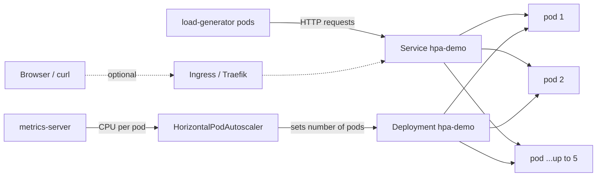
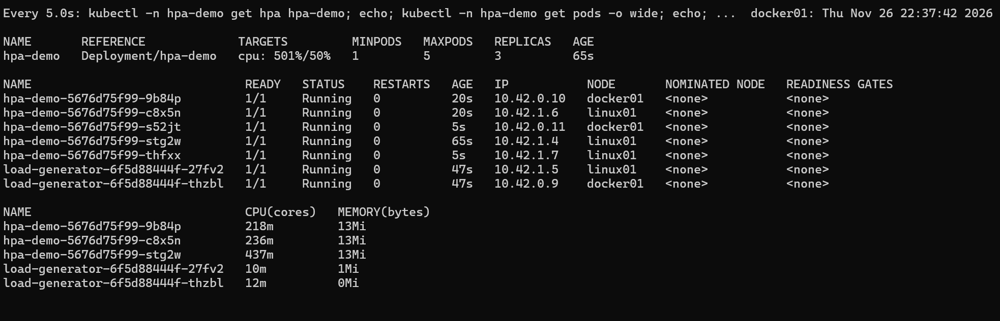
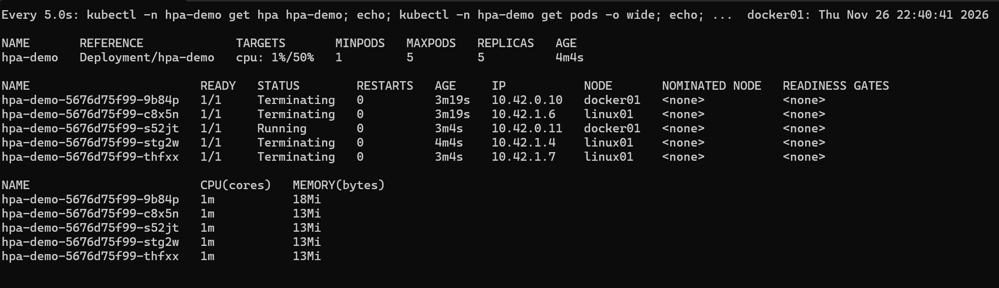
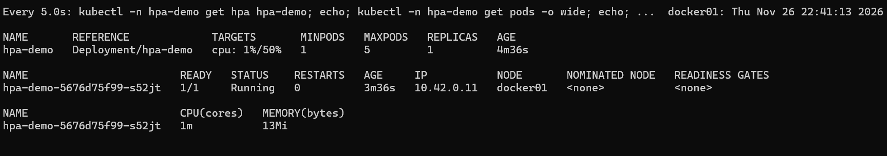

# hpa-demo: load balancing and autoscaling on Kubernetes

A small, self-contained demo you can run on **any Kubernetes cluster** in about 10 minutes.
It shows two things that cloud applications are usually asked to do:

1. **Load balancing:** spread incoming requests across several copies (pods) of an app.
2. **Autoscaling:** add pods automatically when traffic is high, and remove them when it drops.

The app is a tiny Python web server. Every request makes it do some CPU work, and it replies with the
name of the pod that answered, so you can *see* both the load balancing and the scaling happen.

| Requirement | Kubernetes piece | File |
|---|---|---|
| Load balancing inside the cluster | Service | [`k8s/20-service.yaml`](k8s/20-service.yaml) |
| Load balancing from outside (optional) | Ingress (Traefik, built into k3s) | [`k8s/30-ingress.yaml`](k8s/30-ingress.yaml) |
| Scale out when busy, scale in when quiet | HorizontalPodAutoscaler: 1 to 5 pods, target 50% CPU | [`k8s/40-hpa.yaml`](k8s/40-hpa.yaml) |
| Something to scale | Deployment of the demo app | [`k8s/10-deployment.yaml`](k8s/10-deployment.yaml) |
| Traffic to trigger scaling | Load generator (2 pods sending requests in a loop) | [`k8s/load-generator.yaml`](k8s/load-generator.yaml) |

## How it fits together



1. The **load generator** sends requests to the **Service**.
2. The Service spreads them across all ready pods (load balancing).
3. **metrics-server** measures each pod's CPU. The app asks for 100m CPU (a tenth of a core).
4. When average CPU goes above **50%** of that, the **HPA** adds pods, up to 5.
5. When you stop the load, CPU drops. After a 60-second wait the HPA removes pods again, down to 1.

## What you need

- A Kubernetes cluster with **metrics-server** running. Some options:
  - **k3s**: metrics-server and Traefik are included. This is what the author used.
  - **minikube**: run `minikube addons enable metrics-server` first.
  - **kind**, **Docker Desktop** and others: install metrics-server yourself.
- `kubectl` connected to that cluster. Check with `kubectl top nodes`: if it prints CPU and memory, you're ready.
- `git` and `bash`.
- About 1.5 CPU cores free in the cluster while the load test runs.

You do **not** need to build anything. The app image is public:
`ghcr.io/zulhardy/hpa-demo`, built by this repo's pipeline.

## Run it

```bash
git clone https://github.com/zulhardy/homelab.git
cd homelab
```

**1. Deploy**

```bash
SKIP_INGRESS=1 scripts/hpa-demo.sh deploy
```

Leave out `SKIP_INGRESS=1` if your cluster has Traefik (k3s) and you want to open the app in a browser.
Then also set `HPA_DEMO_HOST`, for example `HPA_DEMO_HOST=hpa-demo.<your-node-ip>.nip.io`
([nip.io](https://nip.io) turns that name into the IP inside it).

Expected: `deployment "hpa-demo" successfully rolled out`

**2. Check it answers**

```bash
scripts/hpa-demo.sh test
```

This runs a short-lived pod inside the cluster that sends 10 requests. With 1 pod, every reply has the same name:

```
OK from hpa-demo-5676d75f99-s52jt
OK from hpa-demo-5676d75f99-s52jt
...
```

**3. Start the load and watch it scale out**

```bash
scripts/hpa-demo.sh load-start
scripts/hpa-demo.sh watch
```

Within 1 to 2 minutes, `TARGETS` climbs well above 50% and pods are added until there are 5.
Press `Ctrl+C` to stop watching. The load keeps running.

**4. See the load balancing**

```bash
scripts/hpa-demo.sh test
```

Now the replies come from **different pods**.

**5. Stop the load and watch it scale back in**

```bash
scripts/hpa-demo.sh load-stop
scripts/hpa-demo.sh watch
```

CPU drops to near 0%. After about a minute the extra pods show `Terminating`, and it goes back to 1 pod.

**6. Clean up**

```bash
scripts/hpa-demo.sh delete
```

This removes the whole `hpa-demo` namespace and everything in it.

## What it looked like on the author's homelab

A 2-node k3s cluster (docker01 and linux01, 4 CPU / 8 GB each).

**Under load:** CPU at 501% of target, the HPA has scaled from 1 to 5 pods, spread across both nodes.



**Load stopped:** CPU at 1%, the extra pods are terminating.



**Back to 1 pod**, about 4 minutes after the test started.



## Things you can change

| What | Where | Default |
|---|---|---|
| Min / max pods | `minReplicas`, `maxReplicas` in [`k8s/40-hpa.yaml`](k8s/40-hpa.yaml) | 1 / 5 |
| CPU target | `averageUtilization` in [`k8s/40-hpa.yaml`](k8s/40-hpa.yaml) | 50% |
| How fast it scales back in | `stabilizationWindowSeconds` in [`k8s/40-hpa.yaml`](k8s/40-hpa.yaml) | 60s (Kubernetes default is 300s) |
| CPU work per request | `CPU_WORK_ITERATIONS` env var on the Deployment | 1000000 |
| Amount of load | `replicas` in [`k8s/load-generator.yaml`](k8s/load-generator.yaml) | 2 |

## Troubleshooting

| You see | Likely cause | What to do |
|---|---|---|
| `TARGETS` shows `<unknown>` | metrics-server not installed or still starting | Check `kubectl top pods -n hpa-demo`. Wait a minute, or install metrics-server. |
| Pods stuck in `ImagePullBackOff` | Cluster can't reach `ghcr.io` | Check the nodes have internet access |
| Pods stay `Terminating` for about 30 seconds | The demo app doesn't handle the stop signal (SIGTERM), so Kubernetes waits for its 30s grace period | Harmless in this demo |
| `scripts/hpa-demo-image-tag.sh` says no commit found | The repo was cloned with `--depth 1` | Clone normally (full history), or set `HPA_DEMO_IMAGE` yourself |
| Pods never go above 1 | Not enough load, or the cluster is out of CPU | Raise `replicas` in the load generator; check `kubectl describe hpa -n hpa-demo` |

## How it's built and deployed (on the author's homelab)

Merging a change under `apps/hpa-demo/` into `main` runs
[`.github/workflows/hpa-demo-image.yml`](../../.github/workflows/hpa-demo-image.yml):

1. **Build** (GitHub-hosted runner): [`scripts/hpa-demo-image-tag.sh`](../../scripts/hpa-demo-image-tag.sh) works out
   the tag `sha-<last commit that changed apps/hpa-demo/app>`, and [`scripts/build-image.sh`](../../scripts/build-image.sh)
   builds and pushes `ghcr.io/zulhardy/hpa-demo:<tag>` with GitHub's short-lived per-run token. If that image
   already exists (only manifests changed), it's reused.
2. **Deploy** (self-hosted runner on docker01): [`scripts/ci-deploy-hpa-demo.sh`](../../scripts/ci-deploy-hpa-demo.sh)
   logs in to OpenBao with GitHub's OIDC token, receives a Kubernetes token that expires after 10 minutes and only
   works in the `hpa-demo` namespace, then runs `scripts/hpa-demo.sh deploy` and waits for the rollout.

Who may deploy, and with which permissions, is in [`k8s/05-deploy-rbac.yaml`](k8s/05-deploy-rbac.yaml).
You don't need any of this to *try* the demo on your own cluster: `scripts/hpa-demo.sh deploy` uses your own kubeconfig.

## Security choices

- Base images (`python:3.13-slim`, `busybox:1.37`) are **pinned by digest**, so a rebuild can't silently pick up a different image.
- The app runs as a **non-root** user, with a **read-only filesystem**, **no Linux capabilities**, and no privilege escalation.
- The pipeline only gets `contents: read` and `packages: write`, for that one run.

## Mapping to Azure

Useful for comparing this homelab demo with an Azure design:

| Here (Kubernetes / k3s) | Azure App Service | Azure Kubernetes Service (AKS) |
|---|---|---|
| Service + Ingress | Built-in load balancing across instances | Service + Azure Load Balancer / Application Gateway |
| HorizontalPodAutoscaler | Autoscale rules (scale out/in on CPU or other metrics) | The same HPA, plus the cluster autoscaler for adding nodes |
| metrics-server | Azure Monitor metrics | metrics-server / Azure Monitor |
