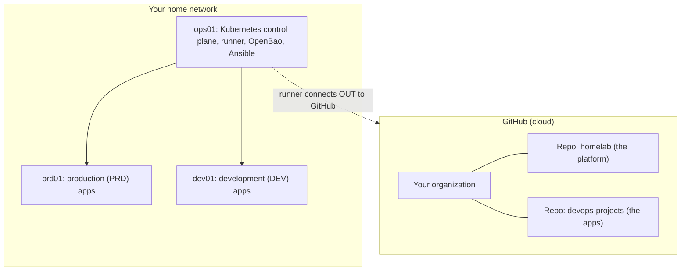

# Build your own homelab: a step-by-step guide

This guide takes you from **nothing** to a working DevOps homelab: three Linux virtual machines (VMs) running
Kubernetes, with a CI/CD pipeline that tests, builds and deploys apps after you merge a pull request.

It's written for people who are new to this. Every step says **what to do**, **why**, and **how to check it worked**.
Take it one part at a time. If something doesn't match what you see, stop and check the
[Troubleshooting](#troubleshooting) table before carrying on.

> **Time needed** [estimate]: about 3–5 hours the first time, spread over a few sittings. You can stop after any part.

## Contents

- [What you'll build](#what-youll-build)
- [How to read this guide](#how-to-read-this-guide)
- [Words you'll see](#words-youll-see)
- [Part 0 — What you need](#part-0--what-you-need)
- [Part 1 — Plan your network](#part-1--plan-your-network)
- [Part 2 — Create the three VMs](#part-2--create-the-three-vms)
- [Part 3 — Set up GitHub](#part-3--set-up-github)
- [Part 4 — Prepare ops01](#part-4--prepare-ops01)
- [Part 5 — Check Ansible can reach every VM](#part-5--check-ansible-can-reach-every-vm)
- [Part 6 — Install Kubernetes (k3s)](#part-6--install-kubernetes-k3s)
- [Part 7 — Install the secrets vault (OpenBao)](#part-7--install-the-secrets-vault-openbao)
- [Part 8 — Install the GitHub runner](#part-8--install-the-github-runner)
- [Part 9 — Run the one-time bootstrap](#part-9--run-the-one-time-bootstrap)
- [Part 10 — Test everything](#part-10--test-everything)
- [Part 11 — What next](#part-11--what-next)
- [Troubleshooting](#troubleshooting)
- [Appendix: moving a repo-level runner to the organization](#appendix-moving-a-repo-level-runner-to-the-organization)

## What you'll build



- **ops01** is the "control room". You type almost every command there.
- **prd01** and **dev01** only run apps: DEV for trying things, PRD for the "real" copy.
- **homelab** (repo) describes how the machines are set up. **devops-projects** (repo) holds the apps.
- After setup, the only things you do by hand are: **review and merge pull requests**, and **approve** risky steps
  (production deploys, changes to the machines).

## How to read this guide

| You see | It means |
|---|---|
| 🌐 **In your browser** | Do this on github.com, on your own PC |
| 💻 **On your PC** | Do this on your own computer (the one running the VMs) |
| 🖥️ **On ops01** | Type this in a terminal on the ops01 VM (Part 4 shows how to open one) |
| `<your-user>` | Replace with **your own** value, without the `< >`. E.g. `<your-user>` → `alex` |
| ✅ **Check** | What you should see if it worked. Don't skip these |
| ⚠️ | Something to be careful with |

Code blocks are meant to be **copied and pasted**. In most terminals, paste is `Ctrl+Shift+V` (Linux) or a
right-click (Windows Terminal).

## Words you'll see

| Word | Meaning |
|---|---|
| **VM** (virtual machine) | A computer simulated inside your real one. You'll make three |
| **Hypervisor** | The program that runs VMs: Hyper-V, VirtualBox, Proxmox, VMware… |
| **SSH** | A secure way to open a terminal on another machine over the network |
| **Ansible** | A tool that sets up machines from a description (a "playbook"), the same way every time |
| **Kubernetes / k3s** | Runs apps in containers and keeps them running. k3s is a small, easy Kubernetes |
| **OpenBao** | A secrets vault. It hands the pipeline short-lived passwords (10 minutes) so none are stored |
| **Runner** | A program on ops01 that runs GitHub Actions jobs inside your home network |
| **Pull request (PR)** | A proposed change. Checks run on it, then a person reviews and merges it |
| **Repo** (repository) | A project folder on GitHub, with its full history |

---

## Part 0 — What you need

- [ ] **A PC** that can run three VMs at once. The VMs need 8 GB RAM between them (4 + 2 + 2), plus what your PC
      needs for itself: 16 GB RAM or more is comfortable [estimate]. About 75 GB free disk space.
- [ ] **A hypervisor** you're comfortable with: Hyper-V, VirtualBox, Proxmox, VMware Workstation, or similar.
- [ ] **Ubuntu Server 26.04 LTS** installer image (ISO) from [ubuntu.com/download/server](https://ubuntu.com/download/server).
      ⚠️ It must be **26.04**: the setup checks this and stops on any other version, because the pinned software
      versions were tested on it.
- [ ] **A GitHub account** (free).
- [ ] **A password manager** (e.g. Bitwarden, KeePassXC, 1Password). You'll store a few keys that must not be lost
      and must not end up in chat, screenshots or the repo.
- [ ] **Your home router's network details.** On Windows, run `ipconfig` in a terminal; on macOS/Linux, `ip a` and
      `ip route`. Note:
  - your PC's IPv4 address (e.g. `192.168.0.50`)
  - the **default gateway** (your router, e.g. `192.168.0.1`)

## Part 1 — Plan your network

**Why:** the machines talk to each other by IP address, so each one needs a **fixed** address that never changes.

Pick three free addresses in your home network. The author's setup:

| VM | Address (author's) | Yours | Memory | CPUs | Disk |
|---|---|---|---|---|---|
| ops01 | 192.168.0.102 | `____________` | 4 GB | 2–4 | 25 GB [estimate] |
| prd01 | 192.168.0.103 | `____________` | 2 GB | 2–4 | 25 GB [estimate] |
| dev01 | 192.168.0.104 | `____________` | 2 GB | 2–4 | 25 GB [estimate] |

- Use the same first three numbers as your PC (e.g. `192.168.0.x` or `192.168.1.x`).
- Pick numbers **outside your router's automatic (DHCP) range**, or reserve them in the router, so the router never
  hands them to another device. If you're not sure, numbers around 100–120 are often free, but check first:
  `ping 192.168.0.102` from your PC should **fail** ("Request timed out" / "unreachable") if the address is free.
- Also choose **one username** you'll use on all three VMs (e.g. `alex`). In this guide it's `<your-user>`.

Write your three addresses down; you'll use them many times.

## Part 2 — Create the three VMs

**Why:** each VM is a separate "computer" with its own job.

### 2.1 What every VM needs (any hypervisor)

| Setting | Value | Why |
|---|---|---|
| Operating system | Ubuntu Server 26.04 LTS (64-bit) | The setup is built and tested for it |
| Memory | ops01 4 GB, prd01 2 GB, dev01 2 GB, **fixed** (no "dynamic memory" / "ballooning") | Kubernetes plans around the memory it sees at start; memory that changes later confuses it |
| CPUs | 2 to 4 | k3s needs at least 2 |
| Disk | ~25 GB each [estimate] | OS, Kubernetes and container images |
| Network | **Bridged** to your home network (not NAT) | Each VM needs its own address on your home network, reachable from your PC and from each other |

### 2.2 Notes for your hypervisor

Only read the one you use. Menu names change between versions; look for the setting by meaning.

<details>
<summary><b>Hyper-V</b> (Windows Pro/Enterprise)</summary>

1. **Hyper-V Manager → Virtual Switch Manager → New virtual network switch → External** → pick your physical network
   adapter → OK. This is the "bridge" to your home network. Create it once and use it for all three VMs.
2. **New → Virtual Machine**: choose **Generation 2**; Startup memory 4096 MB (ops01) or 2048 MB (prd01/dev01) and
   **untick "Use Dynamic Memory"**; connect to the External switch; attach the Ubuntu ISO.
3. Before starting: VM **Settings → Security → Secure Boot → Template: "Microsoft UEFI Certificate Authority"**.
   With the default Windows template, Ubuntu won't boot.
4. **Settings → Processor**: 2 to 4 virtual processors.
</details>

<details>
<summary><b>VirtualBox</b></summary>

1. **New**: type Linux, version Ubuntu (64-bit), memory 4096 MB / 2048 MB, 2+ CPUs, disk ~25 GB. Attach the ISO.
   If it offers "Unattended install", **skip it**: you need to set the network by hand during the install.
2. **Settings → Network → Adapter 1 → Attached to: Bridged Adapter**, Name: your physical network card.
   ⚠️ **NAT won't work**: with NAT, the VMs can't reach each other at their own addresses and you can't SSH in.
3. Bridging over Wi-Fi sometimes fails on laptops. If the VMs get no network in Part 2.3, try a cable, or ask for help.
</details>

<details>
<summary><b>Proxmox VE</b></summary>

1. Upload the Ubuntu ISO to a storage (e.g. **local → ISO Images → Upload**).
2. **Create VM**: OS = the ISO; Disk ~25 GB; CPU 2+ cores; Memory 4096 / 2048 MiB.
   In the Memory tab, tick **Advanced** and **untick "Ballooning Device"** (that's Proxmox's dynamic memory).
3. Network: bridge **vmbr0** (the default bridge to your home network), model VirtIO.
4. Proxmox itself already runs on your network, so the VMs sit next to it with their own addresses.
</details>

<details>
<summary><b>VMware Workstation / Player / Fusion</b></summary>

1. Create a VM from the ISO, choosing "I will install the operating system later" if it offers an easy install, so you
   can set the network by hand.
2. Memory 4 GB / 2 GB, 2+ CPUs, disk ~25 GB.
3. **Network adapter: Bridged** (not NAT, not host-only).
</details>

<details>
<summary><b>Something else</b> (other hypervisor, old PCs, Raspberry Pi…)</summary>

Anything works if it meets the table in 2.1: three Ubuntu Server 26.04 machines (64-bit x86 — the pinned downloads
are for `amd64`), fixed memory, each with its own fixed address on the same network, able to reach the internet.
</details>

### 2.3 Install Ubuntu on each VM

Start the VM and go through the Ubuntu Server installer. Mostly accept the defaults, except:

1. **Network configuration**: choose your network interface → **Edit IPv4** → **Manual**, then:

   | Field | Value (example) |
   |---|---|
   | Subnet | `192.168.0.0/24` (your network, with `.0/24` at the end) |
   | Address | this VM's address from Part 1, e.g. `192.168.0.102` |
   | Gateway | your router, e.g. `192.168.0.1` |
   | Name servers | your router, e.g. `192.168.0.1` (or `1.1.1.1`) |
   | Search domains | leave empty |

2. **Profile**: your name; **server name** = `ops01`, `prd01` or `dev01`; username = `<your-user>` (the same on all
   three); a strong password. Using the **same password** on all three keeps later steps to one password prompt.
3. **SSH**: tick **Install OpenSSH server**. Leave "import SSH key" off.
4. **Featured server snaps**: select nothing. (Docker is **not** needed; Kubernetes brings its own container runtime.)
5. When it says **Reboot now**, reboot. Remove the ISO if the VM boots into the installer again.

Repeat for all three VMs.

✅ **Check** (💻 on your PC, in a terminal such as Windows Terminal or PowerShell):

```bash
ping 192.168.0.102      # use YOUR addresses; each should reply
ping 192.168.0.103
ping 192.168.0.104
ssh <your-user>@192.168.0.102     # answer "yes" to the fingerprint question, then your password
```

You should land at a prompt like `<your-user>@ops01:~$`. Type `exit` to leave.

---

## Part 3 — Set up GitHub

Everything in this part is 🌐 **in your browser**.

### 3.1 Create an organization

**Why:** one self-hosted runner can then serve both of your repos.

1. Go to [github.com/organizations/plan](https://github.com/organizations/plan) → **Free** → pick a name.
   In this guide it's `<your-org>`.
2. It belongs to your account; you're its owner.

### 3.2 Copy the two repos into your organization

1. Open [github.com/zulhardy-lab/homelab](https://github.com/zulhardy-lab/homelab) → green **Use this template** →
   **Create a new repository**.
   - Owner: `<your-org>`, name: `homelab`, **Public**. Then **Create repository**.
2. Do the same for [github.com/zulhardy-lab/devops-projects](https://github.com/zulhardy-lab/devops-projects) →
   name `devops-projects`, **Public**.

> Why public: GitHub-hosted runners and environments with approvals are free for public repos.
> Why "template" and not "fork": a fork stays linked to the original, and its pull requests point at the original
> repo by default. A template copy is fully yours.

### 3.3 Create the approval gates (environments)

**Why:** the pipeline pauses at risky steps until you approve. OpenBao checks these names, so spell them exactly.

In **homelab → Settings → Environments → New environment**:

| Name | Required reviewers | Allow administrators to bypass | Deployment branches and tags |
|---|---|---|---|
| `platform` | ✅ yourself | ❌ unticked | **Selected branches and tags** → add rule `main` |

In **devops-projects → Settings → Environments**:

| Name | Required reviewers | Allow administrators to bypass | Deployment branches and tags |
|---|---|---|---|
| `dev` | ❌ none | (doesn't matter) | **Selected** → `main` |
| `prd` | ✅ yourself | ❌ unticked | **Selected** → `main` |

Click **Save protection rules** after each change.

### 3.4 Put in your own values

**Why:** the copied code contains the author's addresses, username and organization. Change them **before** running
anything.

First get each repo's **ID** (a number that never changes, even if the repo is renamed). Open these addresses in your
browser and copy the number after `"id":` near the top:

- `https://api.github.com/repos/<your-org>/homelab`
- `https://api.github.com/repos/<your-org>/devops-projects`

Now edit the files on GitHub: open the file → pencil icon (**Edit**) → make the change → **Commit changes…** →
**Commit directly to the `main` branch**. (Only during setup. From Part 3.5 on, every change goes through a PR.)

**In `homelab`:**

| File | Change |
|---|---|
| `ansible/inventory/hosts.ini` | The three addresses (`ansible_host=` and `k3s_node_ip=`); `ansible_user=` on prd01 and dev01 → `<your-user>` |
| `ansible/inventory/automation.ini` | The three addresses (`ansible_host=` for prd01/dev01, and every `k3s_node_ip=`). Keep `ansible_user=automation` |
| `ansible/inventory/group_vars/all.yml` | `runner_org_url` → `https://github.com/<your-org>`; `k3s_server_ip` → ops01's address; `k3s_admin_user` → `<your-user>`; keep `homelab_apps: []` for now |
| `scripts/bootstrap-automation.sh` | Near the top: `REPO` → `<your-org>/homelab`, `REPO_ID` → homelab's ID, `PROJECTS_REPO` → `<your-org>/devops-projects`, `PROJECTS_REPO_ID` → devops-projects' ID. Further down, in the line `for h in 127.0.0.1 192.168.0.103 192.168.0.104`: prd01's and dev01's addresses |
| `scripts/lib/ci-openbao-login.sh` | `GITHUB_REPO_API` → `https://api.github.com/repos/<your-org>/homelab` |

**In `devops-projects`:**

| File | Change |
|---|---|
| `scripts/lib/ci-openbao-login.sh` | `GITHUB_REPO_API` → `https://api.github.com/repos/<your-org>/devops-projects` |
| `scripts/lib/envs.sh` | dev → dev01's address, prd → prd01's address |
| `scripts/image-tag.sh` | `ghcr.io/zulhardy-lab/` → `ghcr.io/<your-org>/` (lowercase) |
| `scripts/build-image.sh`, `apps/hpa-demo/app/Dockerfile` | `https://github.com/zulhardy-lab/devops-projects` → `https://github.com/<your-org>/devops-projects` |

> Each commit may start a run in the **Actions** tab. That's expected during setup:
> - Runs that say **Waiting** (for approval) or **Queued** (no runner yet): open them and click **Cancel workflow**.
>   Don't approve anything yet.
> - A failed `apps` run in devops-projects (e.g. it couldn't push an image because not all names were changed yet) is
>   harmless. It runs again after your next change.

✅ **Check:** search each repo for the old values. On the repo page, press `/` and search `zulhardy-lab`, then your
old example address `192.168.0.10`. Only docs and comments should still mention them.

### 3.5 Protect `main`

**Why:** from now on, nothing reaches `main` without a pull request and passing checks.

In **each repo → Settings → Rules → Rulesets → New ruleset → New branch ruleset**:

- Name `protect-main`, Enforcement status **Active**.
- Target branches → **Add target** → **Include default branch**.
- ✅ **Restrict deletions**, ✅ **Block force pushes**.
- ✅ **Require a pull request before merging**, Required approvals **0**. (GitHub doesn't count approvals from the
  PR's author, so with 1 you'd lock yourself out. The PR itself is still required.)
- ✅ **Require status checks to pass** → **Add checks** → `lint` and `quality`. If they aren't listed yet, open any small
  test PR first so they run once, then come back.
- **Create**.

### 3.6 Actions and security settings

In **each repo → Settings**:

- **Actions → General → Approval for running fork pull request workflows from contributors** → **Require approval for
  all external contributors** → **Save**. Strangers' PRs can't run anything until you approve them.
- **Actions → General → Actions permissions** → ✅ **Require actions to be pinned to a full-length commit SHA** → **Save**
  (the workflows already do this).
- **Advanced Security** (or **Code security**) → enable **Secret Protection / secret scanning** and **Push protection**.
  GitHub then blocks pushes that contain known kinds of secrets.

In **your organization → Settings → Actions → Runner groups → Default**:

- ✅ **Allow public repositories** (off by default, because anyone can open PRs on public repos. Here, PR checks never use
  your runner, and fork PRs need your approval).
- **Repository access**: if offered, **Selected repositories** → `homelab` and `devops-projects`.
- **Save**.

---

## Part 4 — Prepare ops01

### 4.1 Open a terminal on ops01

💻 On your PC: `ssh <your-user>@<ops01-address>`. Use this instead of the hypervisor's console window: copy and paste
work properly. Everything in Parts 4 to 10 marked 🖥️ is typed here.

### 4.2 Install the tools

🖥️ **On ops01:**

```bash
sudo apt update
sudo apt install -y ansible git
```

`sudo` asks for your password. Nothing shows while you type it; that's normal.

### 4.3 Let ops01 log in to prd01 and dev01 without a password

**Why:** Ansible on ops01 sets up the other two VMs over SSH. A key is safer and smoother than typing passwords.

🖥️ **On ops01** (replace the addresses with yours):

```bash
ssh-keygen -t ed25519 -C "ops01-admin"
# Press Enter for the default file. Then type a passphrase (and remember it / store it in your password manager).

ssh-copy-id <your-user>@192.168.0.103     # prd01: answer "yes", then prd01's password (the last time you'll need it)
ssh-copy-id <your-user>@192.168.0.104     # dev01: same
```

Now load the key into the **ssh-agent**, so neither you nor Ansible is asked for the passphrase again:

```bash
eval "$(ssh-agent -s)"
ssh-add                    # type the key's passphrase once
```

⚠️ The agent only lasts for this terminal session. **Run those two lines again every time you log in to ops01.**

✅ **Check:**

```bash
ssh <your-user>@192.168.0.103 hostname     # prints prd01, no questions asked
ssh <your-user>@192.168.0.104 hostname     # prints dev01
```

- Asks "Enter passphrase for key"? The agent isn't loaded: run the two `ssh-agent` lines again.
- Asks for `<your-user>@...'s password`? `ssh-copy-id` didn't work: run it again.

### 4.4 Get your homelab repo onto ops01

🖥️ **On ops01:**

```bash
git clone https://github.com/<your-org>/homelab.git ~/homelab
cd ~/homelab
git log --oneline -3      # your own commits from Part 3.4 should be at the top
```

The repo is public, so no password is needed. ops01 only ever **reads** from GitHub; changes go through PRs on
github.com.

---

## Part 5 — Check Ansible can reach every VM

**Why:** a quick, harmless test before Ansible changes anything.

🖥️ **On ops01:**

```bash
cd ~/homelab/ansible
ansible all -m ping -K
```

`-K` asks for your **sudo password** ("BECOME password"). You type it; it's never stored.

✅ **Check:** three green results (`ops01 | SUCCESS`, `prd01 | SUCCESS`, `dev01 | SUCCESS`, each with `"ping": "pong"`).

Then a dry run of the first playbook, which shows what it *would* change without changing anything:

```bash
ansible-playbook playbooks/base.yml -K --check --diff
```

✅ **Check:** it ends with a `PLAY RECAP` where every machine has `failed=0`. If it says *"This homelab targets Ubuntu
26.04"*, that VM has a different Ubuntu version: reinstall it with 26.04.

---

## Part 6 — Install Kubernetes (k3s)

**Why:** Kubernetes is what runs the apps. ops01 becomes the "brain" (control plane); prd01 and dev01 run the apps.

🖥️ **On ops01**, first check that the firewall is off on all three (k3s needs its ports open between the VMs; the
playbook stops if a firewall is active, instead of opening ports behind your back):

```bash
sudo ufw status
ssh -t <your-user>@192.168.0.103 'sudo ufw status'     # -t lets sudo ask for your password
ssh -t <your-user>@192.168.0.104 'sudo ufw status'
```

✅ Each should say `Status: inactive` (Ubuntu Server's default). If one says `active`, ask for help before changing it.

Now install:

```bash
cd ~/homelab/ansible
ansible-playbook playbooks/base.yml playbooks/k3s.yml -K
```

This takes a few minutes. It downloads k3s, checks its fingerprint (checksum), installs it on all three VMs, joins
them into one cluster, and labels prd01 as `prd` and dev01 as `dev`.

✅ **Check:** log out and back in (`exit`, then `ssh` again, and re-run the two `ssh-agent` lines), so your terminal
picks up the new settings. Then:

```bash
kubectl get nodes -L node-restriction.kubernetes.io/env
```

You should see all three **Ready**, with `prd` next to prd01 and `dev` next to dev01:

```
NAME    STATUS   ROLES           AGE   VERSION        ENV
dev01   Ready    <none>          2m    v1.37.2+k3s1   dev
ops01   Ready    control-plane   3m    v1.37.2+k3s1
prd01   Ready    <none>          2m    v1.37.2+k3s1   prd
```

More detail: [K3S.md](K3S.md).

---

## Part 7 — Install the secrets vault (OpenBao)

**Why:** the pipeline needs credentials to change your machines. Instead of storing passwords in GitHub, OpenBao
checks each pipeline job's identity and hands out credentials that expire after **10 minutes**.

🖥️ **On ops01:**

```bash
cd ~/homelab/ansible
ansible-playbook playbooks/openbao.yml -K
```

Log out and back in (so `bao` knows where OpenBao is), then initialise it:

> ⚠️ **The next command prints 3 recovery keys and an initial root token. They are like master passwords.**
> Copy each one straight into your password manager (e.g. one entry "OpenBao homelab"). **Don't** screenshot them,
> paste them into chat or AI tools, or save them in a file. Then run `clear`.

```bash
bao operator init -recovery-shares=3 -recovery-threshold=2
```

- **Recovery keys 1–3**: keep forever. Any **2** of them are needed for admin work (like the bootstrap in Part 9).
- **Initial root token**: keep it **only until the end of Part 9**, where you'll revoke (cancel) it.

```bash
clear
bao status
```

✅ **Check:** `Initialized true`, `Sealed false`, `Seal Type static`, `Recovery Seal true`.
If it says `certificate signed by unknown authority`, run `source /etc/profile.d/openbao.sh` and try again.

More detail: [OPENBAO.md](OPENBAO.md).

---

## Part 8 — Install the GitHub runner

**Why:** the **runner** runs pipeline jobs that must happen inside your home network (changing the VMs, deploying apps).
It connects **out** to GitHub, so nothing on your network is opened to the internet.

1. 🌐 Open `https://github.com/organizations/<your-org>/settings/actions/runners` → **New runner** →
   **New self-hosted runner** → **Linux**, **x64**.
2. Scroll to **Configure**. Find the line `./config.sh --url https://github.com/<your-org> --token XXXXXXXX`.
   - Check the URL ends in your **org name only** (not `/homelab`): that's how you know it's the org page.
   - Copy only the token (after `--token`). Ignore the other commands; the playbook does them for you.
   - The token expires quickly, so go straight to the next step.
3. 🖥️ **On ops01:**

   ```bash
   cd ~/homelab/ansible
   ansible-playbook playbooks/runner.yml -K
   ```

   It asks for your sudo password, then the token (hidden while you paste).

✅ **Check:** 🌐 refresh the org's runners page: `ops01` is listed as **Idle**, with labels `self-hosted`, `homelab`,
`ops01`. And 🖥️ `systemctl list-units 'actions.runner.*'` shows it **running**.

---

## Part 9 — Run the one-time bootstrap

**Why:** this script connects everything: it lets OpenBao create Kubernetes tokens and SSH certificates, tells OpenBao
which GitHub repos and workflows to trust (by repo ID, branch, workflow file and environment), creates the pipeline's
`automation` user on every VM, and then tests all of it.

🖥️ **On ops01** (as yourself, **not** with `sudo`):

```bash
eval "$(ssh-agent -s)" && ssh-add          # if not already done in this terminal
cd ~/homelab && git pull
scripts/bootstrap-automation.sh
```

It asks for your **sudo password** and **2 of your 3 recovery keys** (hidden while you paste). It takes a few minutes.

✅ **Check** the end of the output:

```
  127.0.0.1        ops01: automation can sudo
  192.168.0.103    prd01: automation can sudo
  192.168.0.104    dev01: automation can sudo
  No onboarded apps: DEV/PRD deployer tests skipped ...
  ...
  <your-org>/homelab               id 1234567890 (expected 1234567890)  OK
  <your-org>/devops-projects       id 1234567891 (expected 1234567891)  OK
  <your-org>/homelab/platform          required reviewers: yes (expected yes)  OK
  <your-org>/devops-projects/dev       required reviewers: no (expected no)  OK
  <your-org>/devops-projects/prd       required reviewers: yes (expected yes)  OK
...
== Temporary root token revoked.
```

Every line should end in **OK** (or say `automation can sudo`). A **CHECK** or **MISSING** points at the GitHub
setting or ID to fix; fix it and run the script again (it's safe to re-run).

### 9.1 Revoke the initial root token

The bootstrap made and cancelled its own temporary token. Now cancel the one from Part 7 too, so no all-powerful
token exists:

```bash
read -rsp "Initial root token (hidden): " BAO_TOKEN; echo; export BAO_TOKEN
bao token revoke -self && echo "Revoked."
unset BAO_TOKEN
```

Then delete the initial root token from your password manager. (Keep the 3 recovery keys.)

### 9.2 Back up the auto-unseal key

OpenBao unlocks itself after a reboot using a key file on ops01. **If ops01's disk is lost without a copy of this key,
the vault can't be opened again, not even with the recovery keys.**

> ⚠️ Same rules as before: password manager only, no screenshots, then `clear`.

```bash
sudo base64 -w0 /etc/openbao/seal/homelab-1.key; echo
clear
```

Save the output in your password manager as "OpenBao seal key homelab-1".

---

## Part 10 — Test everything

### 10.1 A pull request runs checks (and not on your runner)

🌐 In `homelab`, edit any doc (e.g. add a line to `README.md`) → **Commit changes…** → **Create a new branch** →
**Propose changes** → **Create pull request**.

✅ **Check:** the PR shows checks `lint`, `repo-scan` and `quality` running and passing. In **Actions**, the jobs say
they ran on GitHub's machines, not on `ops01`. That's on purpose: code that hasn't been reviewed never runs at home.
Merge the PR (or close it).

### 10.2 Direct pushes to `main` are blocked

🌐 Open any file in `homelab` → pencil → change something → **Commit changes…**.

✅ **Check:** the option **Commit directly to the `main` branch** is blocked (or GitHub says the branch is protected).
Cancel.

### 10.3 The homelab pipeline works, with approval

🌐 `homelab` → **Actions** → **homelab** (left) → **Run workflow** → branch `main` → **Run workflow**.

✅ **Check:**
1. The run says **Waiting** → click **Review deployments** → tick `platform` → **Approve and deploy**.
2. It runs on `ops01` and ends **green**. In the log: `== 1. OpenBao login` passes, every `PLAY RECAP` shows
   `failed=0`, and the last step prints `homelab_apps is empty: nothing to onboard.`

### 10.4 The emergency stop works

If a pipeline ever does something you don't want, you stop the runner. Try it once now:

🖥️ **On ops01:**

```bash
systemctl list-units 'actions.runner.*'                 # note the full service name
sudo systemctl stop 'actions.runner.*'                  # STOP
```

✅ 🌐 The org's runners page shows `ops01` **Offline**. Then start it again with the **full** name
(a pattern like `actions.runner.*` works for stop, but not for start):

```bash
sudo systemctl start <the full name you noted>      # e.g. actions.runner.<your-org>.ops01.service
```

✅ Back to **Idle**.

🎉 **Your homelab is ready.** From now on: change things through pull requests, review, merge, approve.

---

## Part 11 — What next

- **Run an app on the homelab** (e.g. the hpa-demo autoscaling demo):
  1. In `homelab`, a PR that sets `homelab_apps: [hpa-demo]` in `ansible/inventory/group_vars/all.yml` → merge →
     approve the `platform` run. That creates the app's DEV and PRD spaces ("onboarding").
  2. In `devops-projects`, a PR that deletes `apps/hpa-demo/deploy.disabled` → merge. It deploys to DEV by itself,
     and to PRD after you approve `prd`.
  3. Open `http://hpa-demo.<dev01-address>.nip.io` in your browser.
- **Add your own app**: see the [devops-projects README](https://github.com/zulhardy-lab/devops-projects#adding-a-project).
- **How the pipelines work, and why**: [AUTOMATION.md](AUTOMATION.md).
- **Every time you log in to ops01** to run Ansible by hand: `eval "$(ssh-agent -s)" && ssh-add` first.

---

## Troubleshooting

| You see | Likely cause | What to do |
|---|---|---|
| VMs can't `ping` each other or your PC | VM network is NAT / host-only, or wrong address | Use **Bridged** (Part 2.1); check the address, subnet and gateway you typed in the installer |
| Ubuntu won't boot on Hyper-V ("no operating system" / Secure Boot error) | Wrong Secure Boot template | VM Settings → Security → template **Microsoft UEFI Certificate Authority** |
| `Enter passphrase for key` during Ansible | ssh-agent not loaded in this terminal | `eval "$(ssh-agent -s)" && ssh-add` |
| `Permission denied (publickey,password)` to prd01/dev01 | Key not copied | `ssh-copy-id <your-user>@<address>` again |
| `This homelab targets Ubuntu 26.04` | A VM runs another Ubuntu version | Reinstall that VM with 26.04 |
| `Stop if UFW is active` | Firewall on | Ask for help: the k3s ports must be opened on purpose (see K3S.md) |
| A node stays `NotReady` | VMs can't reach each other on the k3s ports, or the node is still starting | Wait 2 minutes; check `ping`; on that VM, `sudo journalctl -u k3s-agent -n 50` |
| `kubectl`: "connection refused" / "permission denied" on ops01 | Terminal from before k3s was installed, or `k3s_admin_user` isn't you | Log out and in; check `k3s_admin_user` in `group_vars/all.yml` |
| `bao`: `certificate signed by unknown authority` | Terminal from before OpenBao was installed | `source /etc/profile.d/openbao.sh` |
| `bao status` shows `Sealed true` after a reboot | Seal key file missing or damaged | See [OPENBAO.md](OPENBAO.md), "Back up the auto-unseal key" (restore it) |
| Runner registration fails (the error is hidden as `no_log`) | Expired token, token from a repo page instead of the org page, or `runner_org_url` not updated | Get a fresh **org** token (Part 8); check `runner_org_url`; the runner's own log: `sudo bash -c 'tail -n 30 "$(ls -t /opt/actions-runner/_diag/Runner_*.log \| head -1)"'` |
| Bootstrap: `... CHECK` / `MISSING` | A GitHub setting or repo ID doesn't match | Fix the named environment (Part 3.3) or ID (Part 3.4), re-run the bootstrap |
| Pipeline: `error validating claims` / `job_workflow_ref does not match` | OpenBao trusts a different repo/workflow than the job came from | Check `REPO`/`REPO_ID`/`PROJECTS_*` in the bootstrap (Part 3.4), commit via PR, `git pull` on ops01, re-run the bootstrap |
| Pipeline: `has no required reviewers. Refusing to continue` | An approval gate lost its reviewer | Re-add yourself (Part 3.3) |
| Job stuck on **Queued** | Runner offline, or the runner group doesn't allow this repo / public repos | Runner page shows Idle? Runner group settings (Part 3.6) |
| Job stuck on **Waiting** | It needs your approval | Open the run → **Review deployments** → approve |

Still stuck? Note **which Part and step**, the **exact command**, and the **last 20 lines** of output.
⚠️ Before sharing output with anyone (or any AI tool), check it contains no keys, tokens or passwords.

---

## Appendix: moving a repo-level runner to the organization

Only for older setups where the runner was registered to **one repo** instead of the organization.
`runner.yml` skips registration while an old registration exists, so remove it first.

1. 🌐 The repo the runner belongs to → **Settings → Actions → Runners** → the runner → **Remove**. Copy only the
   token from the Linux removal command.
2. 🖥️ On ops01:

   ```bash
   sudo bash -c 'cd /opt/actions-runner && ./svc.sh stop && ./svc.sh uninstall'
   sudo -u gha-runner bash -c 'cd /opt/actions-runner && ./config.sh remove --token PASTE_TOKEN_HERE'
   ```

3. If step 2 fails with **404 Not Found** (the repo was renamed or moved since the runner was registered):
   🌐 on the runner's page, use **Remove → Force remove this runner**, then 🖥️ clear the old registration:

   ```bash
   sudo rm -f /opt/actions-runner/.runner /opt/actions-runner/.credentials /opt/actions-runner/.credentials_rsaparams /opt/actions-runner/.service
   ls /etc/systemd/system/ | grep actions.runner    # should print nothing
   ```

4. Do [Part 8](#part-8--install-the-github-runner). While the runner is away, post-merge jobs wait in the queue.

## Security notes

- The runner runs as its own user, `gha-runner`, which has no admin rights. Docker isn't installed on the VMs.
- Your runner is used **only** by workflows that run after a merge to `main`. PR checks run on GitHub's machines.
- The inventory files contain private home-network addresses (192.168.x.x) and your username. They're not secrets,
  but they are public in your repo.
- Your admin SSH key on ops01 can reach prd01 and dev01. The pipeline doesn't use it: it uses the `automation` user with
  10-minute certificates from OpenBao ([AUTOMATION.md](AUTOMATION.md)).
- Never commit or share: SSH private keys, the recovery keys, the seal key, runner tokens, `~/.kube/config`.
