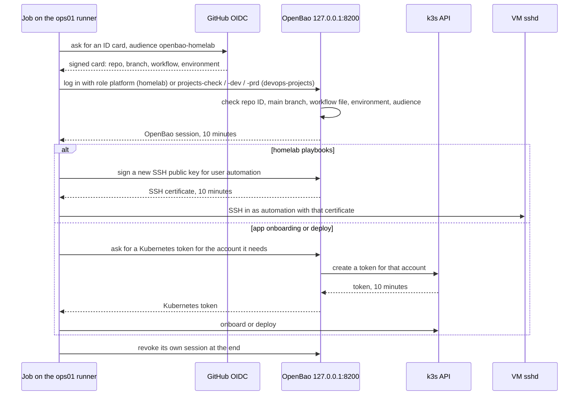

# OpenBao: the homelab's secrets vault

**OpenBao** is an open-source secrets vault (a community version of HashiCorp Vault). Here its job is to be the
pipelines' **credential broker**: a pipeline job proves who it is, and OpenBao hands it a credential that expires
after **10 minutes**. That's why no pipeline stores a password, key or token.

This guide explains how it's set up, how a pipeline logs in, and how to install, check, back up and look after it.

## Contents

- [Words you'll see](#words-youll-see)
- [How it's set up](#how-its-set-up)
- [Accepted trade-off: auto-unseal](#accepted-trade-off-auto-unseal)
- [Back up the auto-unseal key](#back-up-the-auto-unseal-key)
- [Fresh install (a new ops01)](#fresh-install-a-new-ops01)
- [Check that it works](#check-that-it-works)
- [How a pipeline job logs in](#how-a-pipeline-job-logs-in)
- [What's configured inside OpenBao](#whats-configured-inside-openbao)
- [Admin work (needs recovery keys)](#admin-work-needs-recovery-keys)
- [Emergency stop](#emergency-stop)
- [Optional: the web page](#optional-the-web-page)

## Words you'll see

| Word | Meaning |
|---|---|
| **Sealed / unsealed** | A sealed vault is locked: its data is encrypted and nothing can be read. Unsealing unlocks it |
| **Auto-unseal** | The vault unlocks itself after a restart, using a key file, so nobody has to type anything |
| **Recovery keys** | 3 keys, any 2 of which are needed for admin work. You keep them in a password manager |
| **Root token** | A full-power admin login. None is kept day to day: one is made when needed and revoked after |
| **OIDC token** | The signed ID card GitHub gives each pipeline run: which repo, branch, workflow and environment it is |
| **Login role** | A rule in OpenBao: "accept ID cards that look like *this*, and give them *these* permissions" |
| **Policy** | A list of what a login is allowed to do in OpenBao |
| **SSH certificate** | A signed, time-limited permission to log in to a VM, instead of a stored key |

## How it's set up

| | |
|---|---|
| **Version** | 2.7.3, the official `.deb` from the GitHub release, checked against a pinned SHA-256 |
| **Runs on** | ops01, as the `openbao` system user (with the package's hardened service settings) |
| **Address** | `https://127.0.0.1:8200` only, over TLS. It can't be reached from the network, only from ops01 itself |
| **Admin socket** | `/run/openbao/admin.sock`, usable only by the `openbao` user (reach it with `sudo`). Only used to make a new root token from recovery keys (OpenBao 2.5.4 and later block that on normal connections) |
| **Unsealing** | **Automatic** after every restart, with the key file `/etc/openbao/seal/homelab-1.key` |
| **Recovery keys** | 3 keys, any 2 needed. Kept by you in a password manager. Only needed for admin work |
| **Root token** | None day to day. The bootstrap makes one temporarily and revokes it at the end |
| **Data** | `/opt/openbao/data`, encrypted with a key that the seal protects |
| **Client settings** | `/etc/profile.d/openbao.sh` sets `BAO_ADDR` and `BAO_CACERT` for new terminals |

## Accepted trade-off: auto-unseal

⚠️ Anyone with **root on ops01** can read the unseal key file and open the vault. That was chosen so that nothing has
to be typed after a reboot. The pipeline itself can get root on ops01 (through its `automation` SSH certificate), so
**an approved homelab run can reach everything in the vault**. Reviewing the PR, and the `platform` approval, are the
controls.

## Back up the auto-unseal key

⚠️ **Without the key file, the vault's data can't be opened, not even with the recovery keys.** If ops01's disk is
lost, you need both the key and a copy of `/opt/openbao/data` to restore it. Back the key up **once**, after the
bootstrap.

🖥️ **On ops01:**

**Step 1:** Print the key as text.

```bash
sudo base64 -w0 /etc/openbao/seal/homelab-1.key; echo
```

**Step 2:** Copy the output into your password manager, as "OpenBao seal key homelab-1". **Don't screenshot it or
paste it anywhere else.**

**Step 3:** Clear the screen.

```bash
clear
```

**To restore it onto a rebuilt ops01** (replace `<value>` with the saved text):

```bash
echo '<value>' | base64 -d | sudo tee /etc/openbao/seal/homelab-1.key >/dev/null
sudo chown openbao:openbao /etc/openbao/seal/homelab-1.key && sudo chmod 0400 /etc/openbao/seal/homelab-1.key
```

## Fresh install (a new ops01)

🖥️ **On ops01:**

**Step 1:** Install and configure OpenBao.

```bash
cd ~/homelab/ansible
ansible-playbook playbooks/openbao.yml -K
```

**Step 2:** Initialise it. The playbook already sets up auto-unseal, so this produces **recovery keys** straight
away. ⚠️ **Don't screenshot or paste this output:** the keys go into your password manager only.

```bash
bao operator init -recovery-shares=3 -recovery-threshold=2
clear
```

**Step 3:** Run [`scripts/bootstrap-automation.sh`](../scripts/bootstrap-automation.sh) (see
[AUTOMATION.md](AUTOMATION.md#step-2-run-the-bootstrap)). It sets everything else up, and revokes its own root token
at the end. Revoke the root token that step 2 printed too, once the bootstrap has run.

## Check that it works

🖥️ **On ops01:**

```bash
bao status
```

✅ You should see:

| Field | Expected |
|---|---|
| Seal Type | `static` |
| Initialized | `true` |
| Sealed | `false` |
| Recovery Seal | `true` |
| Version | `2.7.3` |

If it says `certificate signed by unknown authority`, this terminal doesn't have the client settings yet. Run
`source /etc/profile.d/openbao.sh` and try again.

## How a pipeline job logs in



In words:

1. The job asks GitHub for an **ID card** (OIDC token) addressed to OpenBao.
2. It logs in to OpenBao with that card. OpenBao checks the repo (by its ID), the branch (`main`), the workflow file
   and the environment against the login role.
3. If everything matches, the job gets an OpenBao session that lasts 10 minutes.
4. With it, it asks for exactly one thing: an SSH certificate (to run playbooks) or a Kubernetes token (to onboard
   or deploy). Each also lasts 10 minutes.
5. At the end, the job revokes its session.

## What's configured inside OpenBao

The bootstrap sets all of this up:

| Path | What it is |
|---|---|
| `auth/jwt-github/role/platform` | Accepts homelab (repo ID 1473136403) `homelab.yml`, environment `platform` (approved). Policy `platform`: sign `automation` SSH certificates, cluster-admin tokens, create Kubernetes roles for the apps in `homelab_apps`. It **can't** change policies, login methods or the SSH certificate authority |
| `auth/jwt-github/role/projects-check` | Accepts devops-projects (repo ID 1473714389) `apps.yml`, no environment. Policy `projects-check`: read which apps are onboarded |
| `auth/jwt-github/role/projects-dev` | Accepts devops-projects `apps.yml`, environment `dev`. Policy `projects-dev`: tokens for `kubernetes/creds/dev-*` only |
| `auth/jwt-github/role/projects-prd` | Accepts devops-projects `apps.yml`, environment `prd` (approved). Policy `projects-prd`: tokens for `kubernetes/creds/prd-*` only |
| (all four roles) | Also require branch `main`, a push or manual run, and audience `openbao-homelab`. Sessions last 10 minutes (15 at most). The bootstrap removes the old `apps-check` / `apps-dev` / `apps-prd` roles |
| `ssh-client-signer/` | The SSH certificate authority. Role `automation`: certificates for the user `automation` only, 10 minutes (15 at most) |
| `kubernetes/` | Makes Kubernetes tokens, using the `openbao-broker` account. Roles: `homelab-platform` (cluster-admin, for onboarding), and for each allowed app `dev-<app>` / `prd-<app>` (that environment's `deployer` only) |

Older setups had a login role called `homelab-platform` (and before that `hpa-demo-deploy`). The bootstrap deletes
them, which only removes access.

## Admin work (needs recovery keys)

There's no admin token lying around. For admin work, **run the bootstrap again**: it makes a temporary root token
from 2 recovery keys over the admin socket, applies the configuration, and revokes the token.

`bao operator generate-root` does **not** work here: since OpenBao 2.6 it uses a newer method that needs an existing
token. The bootstrap uses the older method on the admin socket instead (it's only turned on there).

## Emergency stop

🖥️ **On ops01**, to stop all pipeline credentials (it stays stopped after a reboot):

```bash
sudo systemctl disable --now openbao
```

To turn it back on (it unseals itself):

```bash
sudo systemctl enable --now openbao
```

To stop all pipeline jobs instead: `sudo systemctl stop 'actions.runner.*'`.

## Optional: the web page

OpenBao has a web page (UI), but it only listens on ops01 itself. To open it from your PC, make an SSH tunnel.

💻 **On your PC:**

```bash
ssh -L 8200:127.0.0.1:8200 <your-user>@192.168.0.102
```

Then open `https://127.0.0.1:8200/ui` in your browser, and accept the warning about the self-signed certificate.

Logging in needs a token, and there's none day to day, so the web page is mostly useful during admin work.
