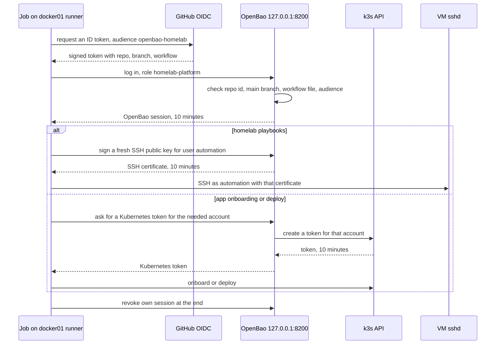

# OpenBao (secrets vault) on docker01

OpenBao is an open-source secrets vault (a community fork of HashiCorp Vault). Here it's the **credential broker**
for the pipelines: a job proves who it is with GitHub's OIDC token, and OpenBao hands out credentials that expire
after 10 minutes. No pipeline stores a password, key or token. See [AUTOMATION.md](AUTOMATION.md) for the pipelines.

| | |
|---|---|
| Version | 2.7.3, official `.deb` from the GitHub release, checked against a pinned SHA-256 |
| Runs on | docker01, as the `openbao` system user (hardened systemd unit from the package) |
| API | `https://127.0.0.1:8200` only (TLS). Not reachable from the network |
| Admin socket | `/run/openbao/admin.sock`, `openbao` user only (reach it with `sudo`). Used only to create a new root token from recovery keys (OpenBao 2.5.4+ blocks that on normal listeners) |
| Unsealing | **Automatic** after every restart, with the key file `/etc/openbao/seal/homelab-1.key` |
| Recovery keys | 3 keys, any 2 needed. Held by you in a password manager. Needed only for admin work (new root token) |
| Root token | None day to day. Created temporarily by the bootstrap and revoked at the end |
| Data | `/opt/openbao/data` (encrypted with a key protected by the seal) |
| Client settings | `/etc/profile.d/openbao.sh` sets `BAO_ADDR` and `BAO_CACERT` for login shells |

## Accepted trade-off: auto-unseal

Anyone with **root on docker01** can read the seal key file and open the vault. That was chosen so nothing has to be
typed after a reboot. The pipeline itself can get root on docker01 (through the `automation` SSH certificate), so
**merging to `main` can reach everything in the vault**. The review before merge is the control.

## Back up the auto-unseal key

**Without the key file, the vault's data can't be opened, not even with the recovery keys.** If docker01's disk is
lost, you'd need the key and a copy of `/opt/openbao/data` to restore. Back the key up once, after the bootstrap:

> Run this, copy the output into your password manager as "OpenBao seal key homelab-1", then run `clear`.
> **Don't screenshot or paste it anywhere else.**

```bash
sudo base64 -w0 /etc/openbao/seal/homelab-1.key; echo
```

To restore it onto a rebuilt docker01: `echo '<value>' | base64 -d | sudo tee /etc/openbao/seal/homelab-1.key >/dev/null`,
then `sudo chown openbao:openbao /etc/openbao/seal/homelab-1.key && sudo chmod 0400 /etc/openbao/seal/homelab-1.key`.

## Fresh install (a new docker01)

```bash
cd ~/homelab/ansible
ansible-playbook playbooks/openbao.yml -K
```

The playbook already configures auto-unseal, so initialising produces **recovery keys** directly:

> **Don't screenshot or paste this output.** The keys go into your password manager only.

```bash
bao operator init -recovery-shares=3 -recovery-threshold=2
clear
```

Then revoke the printed root token once the bootstrap has run (it creates its own when needed), or simply run
[`scripts/bootstrap-automation.sh`](../scripts/bootstrap-automation.sh), which revokes its own token at the end.

## Check it

```bash
bao status
```

| Field | Expected |
|---|---|
| Seal Type | `static` |
| Initialized | `true` |
| Sealed | `false` |
| Recovery Seal | `true` |
| Version | `2.7.3` |

If `bao status` says `certificate signed by unknown authority`, the terminal doesn't have the client settings yet:
`source /etc/profile.d/openbao.sh`.

## How a pipeline job logs in



What's configured in OpenBao (by the bootstrap):

| Path | What |
|---|---|
| `auth/jwt-github/role/homelab-platform` | Accepts GitHub tokens only from repo ID 1473136403, branch `main`, push or manual run, workflow `homelab.yml` or `apps.yml`, audience `openbao-homelab` |
| policy `homelab-platform` | Sign `automation` SSH certificates; get Kubernetes tokens; create Kubernetes roles for new apps. **Can't** change policies, login methods or the SSH CA |
| `ssh-client-signer/` | SSH certificate authority; role `automation`: user certificates for principal `automation` only, 10 minutes (max 15) |
| `kubernetes/` | Mints Kubernetes tokens using the `openbao-broker` account. Roles: `homelab-platform` (cluster-admin, for onboarding) and `<app>-deployer` (one per app) |

## Admin work (needs recovery keys)

There's no standing admin token. For admin work, re-run the bootstrap: it creates a temporary root token from 2
recovery keys over the admin socket, applies the configuration, and revokes the token.

`bao operator generate-root` does **not** work here: since OpenBao 2.6 it uses a new endpoint that needs an existing
token. The bootstrap uses the older endpoint on the admin socket instead (enabled only there).

## Emergency stop

```bash
sudo systemctl disable --now openbao   # stops all pipeline credentials; stays stopped after reboot
sudo systemctl enable --now openbao    # back on (it unseals itself)
```

To stop all post-merge jobs instead: `sudo systemctl stop actions.runner.zulhardy-homelab.docker01.service`.

## Optional: the web UI

The UI only listens on docker01's loopback. From your PC, open an SSH tunnel and browse to it:

```bash
ssh -L 8200:127.0.0.1:8200 zulhardy@192.168.0.102
# then open https://127.0.0.1:8200/ui on your PC (accept the self-signed certificate warning)
```

Logging in needs a token, and there's none day to day, so the UI is mostly useful during admin work.
