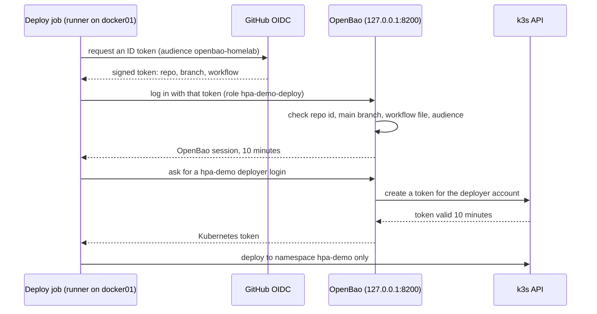

# OpenBao (secrets vault) on docker01

OpenBao is an open-source secrets vault (a community fork of HashiCorp Vault). In this homelab it will act as the
**credential broker**: the deploy pipeline will log in with GitHub's short-lived OIDC token and receive a
Kubernetes login that expires after minutes, so no long-lived cluster credential is stored for the pipeline.

| | |
|---|---|
| Version | 2.7.3, official `.deb` from the GitHub release, checked against a pinned SHA-256 |
| Runs on | docker01, as the `openbao` system user (hardened systemd unit from the package) |
| Listens on | `https://127.0.0.1:8200` only. Not reachable from the network. |
| TLS | Self-signed certificate for `127.0.0.1` and `localhost`; public part at `/etc/openbao/tls-ca.crt` |
| Data | `/opt/openbao/data` (encrypted at rest by OpenBao) |
| Client settings | `/etc/profile.d/openbao.sh` sets `BAO_ADDR` and `BAO_CACERT` for every login shell |

## Install (run on docker01)

```bash
cd ~/homelab && git pull
cd ansible
ansible-playbook playbooks/openbao.yml -K
```

The last task prints `OpenBao is NOT initialised yet and sealed.` That's expected.

## Initialise (one time only, by you)

Initialising creates:

- **3 unseal keys.** Any **2** of them unlock ("unseal") the vault after a restart.
- **1 root token**: full admin access to the vault.

> **Do not screenshot, paste or save this output anywhere except your password manager.**
> Anyone with 2 unseal keys and the data folder, or with the root token, can read every secret.

Open a **new terminal** on docker01 (so `BAO_ADDR` is set), then:

```bash
bao operator init -key-shares=3 -key-threshold=2
```

1. Copy the 3 `Unseal Key` lines and the `Initial Root Token` into your password manager, as separate entries.
2. Run `clear` to wipe them from the screen.

## Unseal (after initialising, and after every docker01 reboot)

OpenBao starts **sealed** every time the service restarts. While sealed, it can't hand out anything, and
automatic deploys will fail until you unseal it.

```bash
bao operator unseal     # paste unseal key 1 when asked (input is hidden)
bao operator unseal     # paste unseal key 2
bao status              # "Sealed  false" means it's ready
```

## Check it

```bash
bao status
```

| Field | Expected after init + unseal |
|---|---|
| Initialized | true |
| Sealed | false |
| Version | 2.7.3 |

Exit codes: `0` = unsealed, `2` = sealed, `1` = error (e.g. the service isn't running: `sudo systemctl status openbao`).

## Connect GitHub and Kubernetes (one time, by you)

This is what lets the deploy pipeline get a Kubernetes login **without storing one**:



Run on docker01, in a terminal where `bao status` works and shows `Sealed false`:

```bash
cd ~/homelab && git pull
scripts/openbao-setup.sh
```

It asks for the **root token** (input hidden; paste it from your password manager). At the end it runs a
self-test with a real 10-minute deployer token (Kubernetes refuses tokens shorter than 10 minutes). Expected:

```
  can patch deployments in hpa-demo:               yes
  can read secrets in hpa-demo:                    no
  can patch deployments in kube-system:            no
  can create namespaces:                           no
```

What it creates:

| Where | What | Can do |
|---|---|---|
| Kubernetes, namespace `openbao` | ServiceAccount `openbao-broker` + its token (stored inside OpenBao) | Only create tokens for hpa-demo's `deployer` |
| Kubernetes, namespace `hpa-demo` | ServiceAccount `deployer` + Role | Create/update the app's Deployment, Service, Ingress, HPA; read pods. No secrets, no deletes, nothing outside `hpa-demo` |
| OpenBao | `kubernetes/` secrets engine, role `hpa-demo-deployer` | Mints deployer tokens: 10 minutes by default, 30 at most |
| OpenBao | `jwt-github/` login, role `hpa-demo-deploy` | Accepts only GitHub tokens from repo ID 1473136403, branch `main`, workflow `hpa-demo-image.yml`, push or manual run, audience `openbao-homelab` |
| OpenBao | policy `hpa-demo-deploy` | The GitHub login may only ask for a hpa-demo deployer token |

## Automatic deploys (how it's used)

The deploy job in [`.github/workflows/hpa-demo-image.yml`](../.github/workflows/hpa-demo-image.yml) runs
[`scripts/ci-deploy-hpa-demo.sh`](../scripts/ci-deploy-hpa-demo.sh) on docker01's runner after every merge that
changes hpa-demo. It follows the sequence above, then revokes its OpenBao session and deletes its temporary
kubeconfig. If OpenBao is sealed, the job fails with "OpenBao is sealed": unseal it and re-run the job
(Actions tab → the failed run → **Re-run jobs**).

The GitHub login is pinned to that workflow **file name**. Renaming or moving the file stops deploys until
`WORKFLOW_REF` in `scripts/openbao-setup.sh` is updated and the script is re-run (needs a new root token,
`bao operator generate-root`).

## Root token

After the self-test shows `yes, no, no, no`, answer **y** when `scripts/openbao-setup.sh` asks
"Revoke the root token now?". Nothing needs it day to day. You can then delete it from your password manager too. If you ever need admin access again, generate a new
root token from 2 of the unseal keys (`bao operator generate-root`).

## Optional: the web UI

The UI only listens on docker01's loopback. From your PC, open an SSH tunnel and browse to it:

```bash
ssh -L 8200:127.0.0.1:8200 zulhardy@192.168.0.102
# then open https://127.0.0.1:8200/ui on your PC (accept the self-signed certificate warning)
```

## Emergency stop

```bash
bao operator seal          # locks the vault immediately (needs a token with permission, e.g. root)
sudo systemctl stop openbao
```

Either one stops all credential minting, so automatic deploys stop too.
